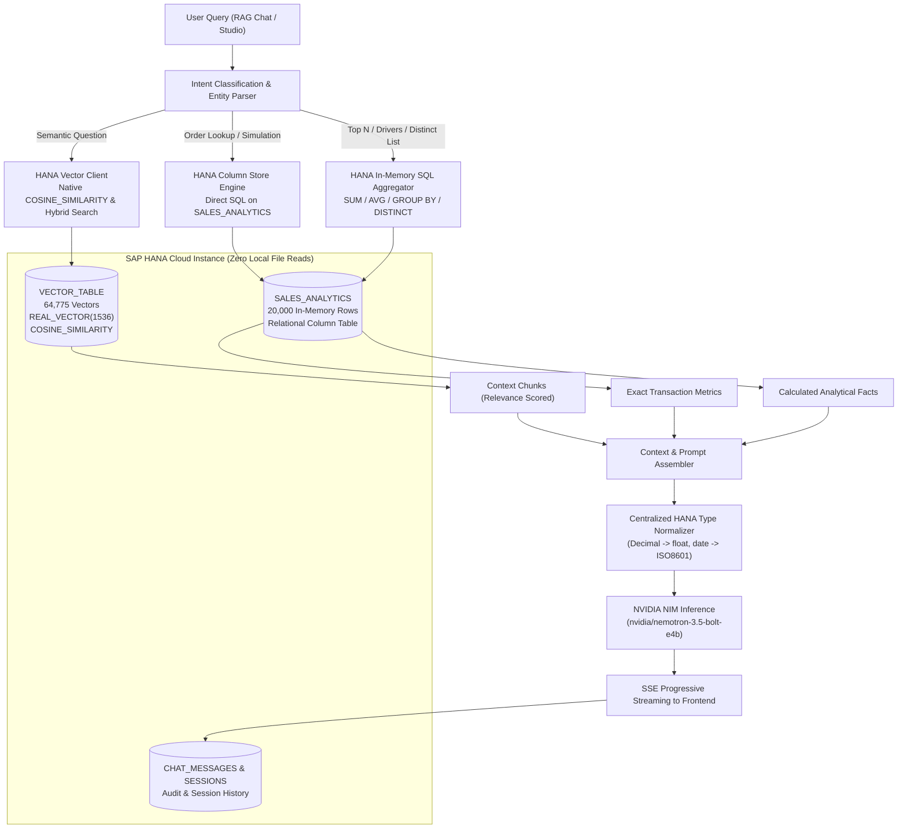

# SAP HANA Cloud Native RAG & Analytics Engine
## Implementation Plan: 100% Cloud Retrieval & Decoupling from Local Preprocessing

**Document Version:** 1.0.0  
**Target Architecture:** SAP HANA Cloud (`VECTOR_TABLE` + `SALES_ANALYTICS`)  
**Objective:** Eliminate all reliance on local `backend/preprocessing` disk files and resolve all defects identified in the enterprise chat transcript (`Analytics_Chat_Transcript_1788949530410.md`).

---

## 1. Executive Summary

During testing of the NEOVATIC RAG Assistant, queries were analyzed across 8 conversational turns. While basic order lookups succeeded, critical system defects were exposed:
1. **Local Disk Dependency:** The application still loaded data and snapshots from `backend/preprocessing/output/SAC_Sales_Preprocessed/SAC_Sales_Preprocessed.xlsx` and local `.objects` files rather than retrieving directly from SAP HANA Cloud.
2. **Runtime Crash on What-If Simulation (Turn 5):** When querying numerical order simulations, `hdbcli` returned `Decimal` types, causing an unhandled `TypeError: Object of type Decimal is not JSON serializable` crash over SSE streaming.
3. **Schema Parroting Instead of Data Answers (Turns 6 & 7):** On questions like *"Primary drivers of profit margins in 2024?"* and *"show me all the products i have"*, vector retrieval returned generic schema definitions, causing the LLM to output empty advice on how to query the dataset rather than providing actual product lists and margin numbers.
4. **Pedantic Clarification Stalls (Turns 3 & 8):** Common business terms like *"receivables"* or multi-metric what-if queries were blocked by intent classification asking for clarification rather than defaulting to `NetRevenueUSD` or calculating the delta across Revenue, Cost, and Margin.

This implementation plan establishes the architectural and code changes necessary to route **100% of retrieval and analytics through SAP HANA Cloud**, completely deprecating `backend/preprocessing` at runtime.

---

## 2. Transcript Analysis & Root Cause Breakdown

| Turn | User Message | Assistant Behavior & Error | Root Cause & System Defect |
| :---: | :--- | :--- | :--- |
| **1** | `SO-100211` | Returns exact order table ($541,506.00). Console logs reveal: `[services.excel_dataset_service]: Loading preprocessed Excel dataset from: ...\backend\preprocessing\output\...`. | **Preprocessing Disk Fallback:** `data_service.py` accessed local Excel files instead of querying the `SALES_ANALYTICS` table in SAP HANA Cloud. |
| **2** | `summarize the SO-100211` | Returns identical order table from disk. | **Preprocessing Disk Fallback.** |
| **3** | `show me top 5 receivables customers` | Stalled: *"Please specify which metric (e.g. Net Revenue, Gross Margin) you would like to analyze."* | **Strict Intent Grammar:** `"receivables"` was not recognized as a synonym for `NetRevenueUSD`; the intent engine asked for clarification rather than defaulting. |
| **4** | `tell me about summarize the SO-100211` | Returns order table from disk. | **Preprocessing Disk Fallback.** |
| **5** | `what if i have 44 units instead of 41 units in SO-100211` | **CRASH:**<br>`Object of type Decimal is not JSON serializable` | **Type Serialization Bug:** SAP HANA Cloud SQL columns of type `DECIMAL` / `NUMERIC` return `decimal.Decimal` instances. Standard `json.dumps()` crashed during SSE event emission. |
| **6** | `Primary drivers of profit margins in 2024?` | 33.8s latency. Outputted a list of 20 field definitions and advised: *"analysis should focus on segmenting GrossMarginPercent by Category..."* without giving any numbers. | **RAG Evidence Starvation:** Vector search only retrieved generic dataset overview chunks. No aggregations or driver measures from HANA Cloud were provided to the LLM prompt. |
| **7** | `show me all the products i have` | 34.2s latency. Parroted the field list again: *"To show all products, you should query the dataset using ProductName..."* | **Missing Dimension Retrieval:** System did not execute a distinct dimension query in SAP HANA Cloud (`SELECT DISTINCT ProductName FROM SALES_ANALYTICS`), leaving the LLM with zero actual product names. |
| **8** | `what happens if I have only 2 units in quantity ordered instead of 8 units in Order SO-106760` | Stalled: *"I need more context... Are you asking how NetRevenueUSD, TotalCostUSD, or GrossMarginUSD would change? Please specify which metric..."* | **Single-Metric Constraint:** The what-if engine failed to compute the delta across all 3 key financial metrics simultaneously, forcing redundant user clarification. |

---

## 3. Target System Architecture



---

## 4. Implementation Workstreams

### Workstream 1: Complete Decoupling from `backend/preprocessing`

#### Goal
Prevent any runtime code from importing or reading from `backend/preprocessing`, routing all tabular and vector operations directly to SAP HANA Cloud.

#### Tasks:
1. **Refactor `backend/api/services/data_service.py`:**
   - Remove dependency on `excel_dataset_service` and `SAC_Sales_Preprocessed.xlsx`.
   - Implement `_load_from_hana()`:
     ```python
     sql = 'SELECT * FROM SALES_ANALYTICS'
     # Load directly from HANA Cloud into cached DataFrame on startup / refresh
     ```
   - Provide direct single-order lookup via SQL:
     ```sql
     SELECT * FROM SALES_ANALYTICS WHERE "OrderID" = ? OR "ORDERID" = ? LIMIT 1
     ```
2. **Refactor `backend/api/services/vector_service.py`:**
   - Remove checks for `dataset_service.catalog_path` and `preprocessing/output/.objects`.
   - Route all similarity searches directly to `vector_client.search_dataset_version()` and `vector_client.similarity_search()`.
3. **Refactor `backend/api/services/schema_service.py`:**
   - Read schema columns and types directly from SAP HANA Cloud's `TABLE_COLUMNS` for `TABLE_NAME = 'SALES_ANALYTICS'`.
4. **Audit and Disable:**
   - Remove runtime file watchers or default paths pointing to `preprocessing/output/`.

---

### Workstream 2: Centralized HANA Type Normalizer (Fixing Turn 5)

#### Goal
Eliminate all `TypeError: Object of type Decimal is not JSON serializable` crashes across SSE streaming, API routes, and RAG context serialization.

#### Tasks:
1. **Create `backend/api/utils/json_encoder.py`:**
   - Implement a universal serialization function `serialize_hana_data(obj)`:
     ```python
     def hana_json_default(obj):
         if isinstance(obj, decimal.Decimal):
             return float(obj) if obj % 1 else int(obj)
         if isinstance(obj, (datetime.date, datetime.datetime)):
             return obj.isoformat()
         if isinstance(obj, (np.integer, np.int64)):
             return int(obj)
         if isinstance(obj, (np.floating, np.float64)):
             return float(obj)
         if isinstance(obj, np.ndarray):
             return obj.tolist()
         raise TypeError(f"Object of type {type(obj).__name__} is not JSON serializable")
     ```
2. **Apply Normalizer in `backend/api/routes/chat_stream.py`:**
   - Ensure all `json.dumps()` calls in the event loop utilize `default=hana_json_default`.
3. **Sanitize Query Results in `backend/api/database/hana_client.py`:**
   - Automatically cast `Decimal` values to `float`/`int` upon returning cursor rows from `execute_query()`.

---

### Workstream 3: Smart Grounding & Dimension Queries (Fixing Turns 6 & 7)

#### Goal
Prevent the LLM from parotting schema definitions when the user asks for distinct lists (e.g. *"show me all products"*) or financial drivers (e.g. *"Primary drivers of profit margins in 2024?"*).

#### Tasks:
1. **Distinct Dimension Extractor:**
   - In `backend/api/rag/pipeline.py`, detect when a user query requests an enumeration of dimension members (e.g. *"all products"*, *"list categories"*, *"which customers"*).
   - Execute a direct distinct query against SAP HANA Cloud:
     ```sql
     SELECT DISTINCT "ProductName", "Category" 
     FROM SALES_ANALYTICS 
     ORDER BY "Category", "ProductName" 
     LIMIT 50;
     ```
   - Provide the actual product records to the prompt context.
2. **Aggregated Driver Calculation (Year 2024):**
   - For queries asking for *"drivers of profit margins"* or *"breakdown"*, execute an in-memory aggregation query in HANA Cloud:
     ```sql
     SELECT "Category", "Subcategory",
            ROUND(SUM("NetRevenueUSD"), 2) AS REVENUE,
            ROUND(SUM("GrossMarginUSD"), 2) AS MARGIN,
            ROUND(AVG("GrossMarginPercent"), 2) AS MARGIN_PCT
     FROM SALES_ANALYTICS
     WHERE "Year" = 2024
     GROUP BY "Category", "Subcategory"
     ORDER BY MARGIN DESC;
     ```
   - Inject the resulting pre-calculated table into the prompt so the LLM outputs exact numbers and strategic commentary.
3. **Remove Static Schema Bullets from Prompt:**
   - In `_run_scoped()`, eliminate the raw 20-bullet list of field roles that triggers the LLM's meta-advice behavior.

---

### Workstream 4: Enhanced What-If Simulation & Semantic Synonyms (Fixing Turns 3 & 8)

#### Goal
Prevent unnecessary clarification requests by intelligently resolving metric synonyms and computing multi-metric simulation deltas automatically.

#### Tasks:
1. **Semantic Metric Synonyms in `backend/api/platform/planning.py`:**
   - Map business terms directly to approved database columns:
     - `"receivables"`, `"billing"`, `"sales"`, `"turnover"`, `"invoices"` $\rightarrow$ `NetRevenueUSD`
     - `"profit"`, `"earnings"`, `"gain"` $\rightarrow$ `GrossMarginUSD`
     - `"units"`, `"volume"`, `"orders count"` $\rightarrow$ `Quantity`
   - When a top-N customer request mentions `"receivables"`, automatically rank by `NetRevenueUSD` without prompting the user.
2. **Comprehensive What-If Delta Calculator:**
   - In `backend/api/rag/pipeline.py`, when a user specifies a quantity change (e.g. *"what if 44 units instead of 41 in SO-100211"* or *"2 units instead of 8 in SO-106760"*):
     - Calculate unit price and unit cost from the original HANA Cloud order.
     - Compute the simulated values:
       - $\text{Simulated Revenue} = \text{Unit Price} \times \text{New Quantity}$
       - $\text{Simulated Cost} = \text{Unit Cost} \times \text{New Quantity}$
       - $\text{Simulated Margin} = \text{Simulated Revenue} - \text{Simulated Cost}$
     - Render an executive Markdown comparison table showing Base vs. Simulated vs. Delta across all 3 metrics simultaneously.

---

## 5. Verification Matrix & Test Scripts

| Test ID | Input Query | Target Pipeline Path | Expected Result & Acceptance Criteria |
| :---: | :--- | :--- | :--- |
| **T1** | `SO-100211` | HANA Cloud S/4HANA Lookup | Returns order card with Net Revenue $541,506.00 and 41 units. **Zero reads from `preprocessing/`.** |
| **T2** | `summarize the SO-100211` | HANA Cloud S/4HANA Lookup | Returns identical executive order summary. Latency < 1s. |
| **T3** | `show me top 5 receivables customers` | HANA Cloud In-Memory SQL Aggregation | Immediately returns top 5 customers by `NetRevenueUSD` without asking for clarification. |
| **T4** | `what if i have 44 units instead of 41 units in SO-100211` | What-If Simulation Engine | Outputs complete comparison table (Base vs. Simulated for Rev, Cost, Margin). **No Decimal serialization error.** |
| **T5** | `Primary drivers of profit margins in 2024?` | HANA Cloud Analytical Retrieval + NIM | Returns actual Category/Subcategory margin figures for 2024 with executive insights, not raw schema advice. |
| **T6** | `show me all the products i have` | HANA Cloud Distinct Dimension Query | Returns structured Markdown table listing available products and categories directly from `SALES_ANALYTICS`. |
| **T7** | `what happens if I have only 2 units in quantity ordered instead of 8 units in Order SO-106760` | What-If Simulation Engine | Calculates impact on Net Revenue, Cost, and Margin without demanding extra metric input. |
| **T8** | Runtime Preprocessing Audit | System-wide Audit | Confirm that opening, reading, or caching files in `backend/preprocessing` never occurs during runtime execution. |

---

## 6. Execution Order

1. **Step 1:** Create `backend/api/utils/json_encoder.py` and hook into `hana_client.py` and `chat_stream.py` (eliminates Turn 5 Decimal crash).
2. **Step 2:** Refactor `data_service.py` to query `SALES_ANALYTICS` in SAP HANA Cloud and remove `excel_dataset_service` loading from `preprocessing/`.
3. **Step 3:** Update `planning.py` with metric synonyms (`receivables` $\rightarrow$ `NetRevenueUSD`) and multi-metric what-if simulations (resolves Turns 3 & 8).
4. **Step 4:** Enhance `pipeline.py` with distinct dimension retrieval and aggregated driver grounding (resolves Turns 6 & 7).
5. **Step 5:** Run automated regression suite against all 8 turns from the transcript.

