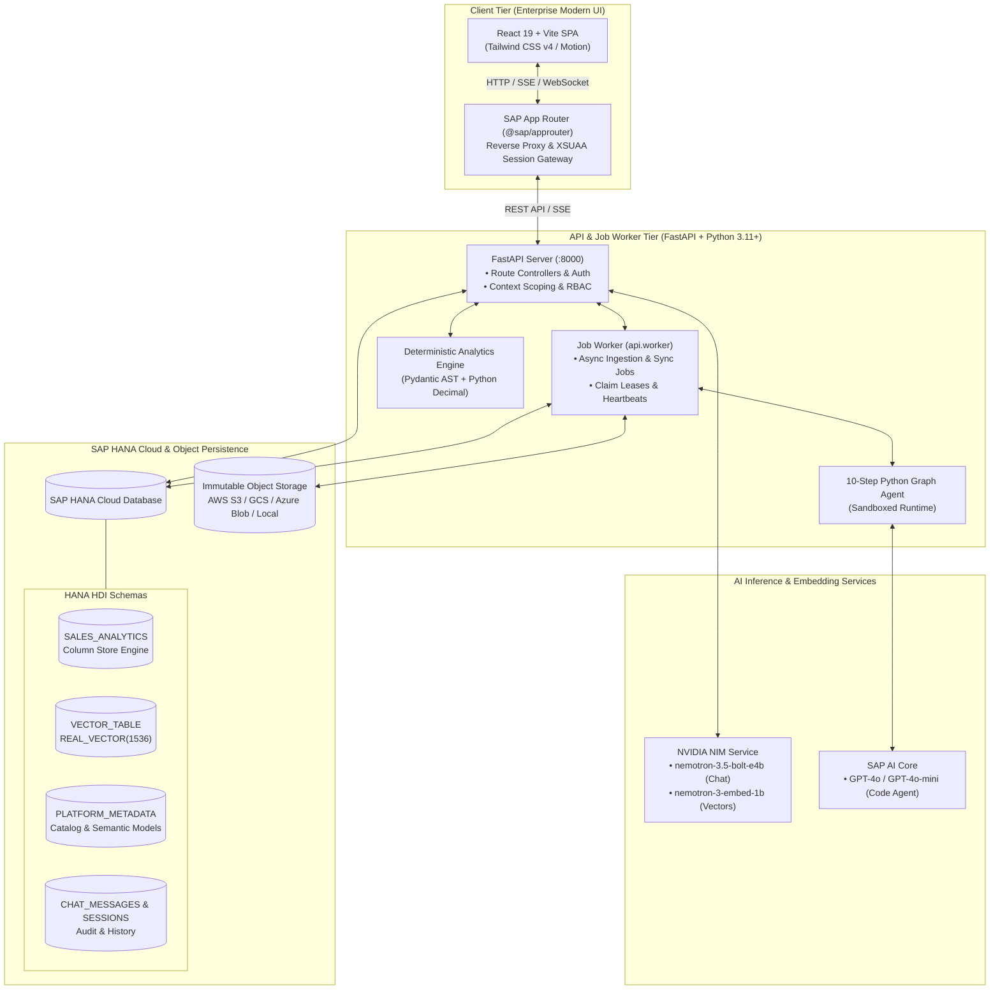

# GEN-AI Analytics Platform

[](https://www.sap.com/products/technology-platform.html)
[](https://help.sap.com/docs/hana-cloud)
[](https://help.sap.com/docs/sap-ai-core)
[](https://build.nvidia.com/)
[](https://fastapi.tiangolo.com/)
[](https://react.dev/)

An enterprise-grade, **metadata-driven Generative AI Analytics Platform** architected for **SAP BTP Cloud Foundry** and hybrid cloud environments. The platform bridges natural language conversational intelligence and mathematical precision through **dual-path deterministic query verification**, **SAP HANA Cloud Native Vector Engine RAG**, **3-Mode KPI & Graph Studio**, and an extensible **enterprise connector ecosystem**.

---

## Table of Contents

- [Business Requirements & Value Proposition](#business-requirements--value-proposition)
- [System Architecture](#system-architecture)
- [Key Platform Capabilities](#key-platform-capabilities)
  - [1. Executive Analytics Dashboard](#1-executive-analytics-dashboard)
  - [2. "Build Your KPI" 3-Mode Studio](#2-build-your-kpi-3-mode-studio)
  - [3. Cloud-Native RAG & Conversational AI Assistant](#3-cloud-native-rag--conversational-ai-assistant)
  - [4. AI Multi-Agent Autonomous Studio](#4-ai-multi-agent-autonomous-studio)
  - [5. Dataset Ingestion, Versioning & Semantic Modeling](#5-dataset-ingestion-versioning--semantic-modeling)
  - [6. SAP HANA Cloud Live Administration](#6-sap-hana-cloud-live-administration)
  - [7. Enterprise Data Connectors & Sync Engine](#7-enterprise-data-connectors--sync-engine)
  - [8. Real-Time Token Consumption & Cost Tracker](#8-real-time-token-consumption--cost-tracker)
- [Directory Structure](#directory-structure)
- [Tech Stack](#tech-stack)
- [Environment Configuration](#environment-configuration)
- [Local Development Setup](#local-development-setup)
- [Production Deployment (SAP BTP CF)](#production-deployment-sap-btp-cf)
- [API Reference](#api-reference)
- [Database Schema & Migrations](#database-schema--migrations)
- [Security, RBAC & Governance](#security-rbac--governance)
- [Testing & Quality Verification](#testing--quality-verification)

---

## Business Requirements & Value Proposition

Traditional enterprise BI and dashboarding solutions suffer from high latency in report generation, rigid semantic models, and inability to handle ad-hoc natural language requests. Conversely, ungrounded Large Language Models (LLMs) hallucinate metrics, fail at numerical precision, and present data security vulnerabilities.

The **GEN-AI Analytics Platform** fulfills enterprise-grade business requirements:

1. **Dual-Path Mathematical Verification**:
   - Eliminates LLM numerical hallucinations by executing analytical queries through validated query plans with 38-digit Python `Decimal` working precision.
   - LLMs summarize narratives and context; deterministic calculation engines compute totals, margins, and ratios.
2. **100% Cloud-Native Retrieval (Zero Local File Fallback)**:
   - Queries and vector searches are performed natively against **SAP HANA Cloud** (`SALES_ANALYTICS` in-memory column store and `VECTOR_TABLE` with 1536-dimensional cosine similarity).
   - Local preprocessing directories are decoupled from runtime execution.
3. **Enterprise Governance & Multi-Version Datasets**:
   - Worksheets and source files are imported with immutable versioning.
   - Semantic models undergo formal proposal, review, revision, and approval stages before publishing to dashboards.
4. **Universal Integration Fabric**:
   - Native connections for SAP S/4HANA, SAP Analytics Cloud (SAC Data Export API), SAP HANA Cloud, REST, OData v2/v4, SOAP (Zeep), Amazon S3, Google Cloud Storage, and Azure Blob Storage.
   - Credentials are encrypted at rest using industry-standard Fernet envelope encryption.
5. **Multi-Turn Business Simulation (What-If Analysis)**:
   - Allows executives to simulate parameter variations (e.g., unit quantities, price fluctuations, regional tax shifts) with instant multi-metric delta computations.

---

## System Architecture



---

## Key Platform Capabilities

### 1. Executive Analytics Dashboard
- **Dynamic KPI Tiles**: Real-time aggregated financial facts (Total Revenue, Gross Margin, Order Count, Net Margin %) with contextual trend indicators.
- **Interactive SVG Visualizations**: Monthly revenue trajectories, category performance, regional distribution, and top-selling SKU charts with interactive tooltip scrubbing and collision-free temporal X-axis sorting.
- **Embedded Analytics Data Grid**: Tabular breakdowns with currency formatting, sorting, and inline search.
- **Context Bar Synchronization**: Automatically binds to the active dataset version and approved semantic model revision.

### 2. "Build Your KPI" 3-Mode Studio
Located under `Build Your KPI` (`/build-your-kpi-graph-studio`), providing three creation pathways:
- **Mode 1: Visual KPI & Widget Builder**:
  - No-code business form: select Target Measure (`NetRevenueUSD`, `GrossMarginUSD`, etc.), Aggregation (`SUM`, `AVG`, `COUNT`), Dimension (`Region`, `Category`, `Date`), and Widget Type (`Stat KPI`, `Bar`, `Line`, `Pie`, `Scatter`, `Data Table`).
  - Saves definition proposals to the review queue with live previews and single-click publication to the Executive Dashboard.
- **Mode 2: AI Core Custom Graph (10-Step Sandboxed Python Agent)**:
  - Powered by SAP AI Core GPT-4o-mini and Matplotlib/Seaborn.
  - Multi-step verified execution:
    1. Schema and data types inspection.
    2. Prompt reasoning & chart recommendation.
    3. Dual-path deterministic pre-computation.
    4. Isolated script compilation (`temp_graph_<id>.py`).
    5. Sandboxed execution (60s timeout, non-root, zero network access).
    6. High-res PNG extraction to base64 data URI.
    7. Automated artifact and memory cleanup.
- **Mode 3: Data-Driven Automated Custom Graph**:
  - Structured visual controls for advanced analytical visualizations (Seaborn Heatmaps, Pareto Charts, Waterfall Revenue Bridges, Violin Distribution Plots, Treemaps) without requiring natural language prompts.

### 3. Cloud-Native RAG & Conversational AI Assistant
- **Direct HANA Cloud Vector Engine**: Real-time cosine similarity search across 1536-dimensional embeddings in `VECTOR_TABLE`.
- **Hybrid Context Assembly**: Merges semantic vector text chunks with direct SQL aggregations on `SALES_ANALYTICS`.
- **Real-Time Token-by-Token SSE Streaming**: Streamlined responses via Server-Sent Events with low latency.
- **Collapsible Thinking Process Inspector**: Displays query decomposition, retrieved context chunks, and SQL translation steps.
- **What-If Simulation Engine**: Multi-metric numerical what-if simulation (e.g., changes in order unit quantity or discounts) computing simultaneous adjustments across Revenue, Cost, and Gross Margin without JSON serialization exceptions (`Decimal` to `float` normalization).

### 4. AI Multi-Agent Autonomous Studio
Accessible via `/ai-agents`, orchestrating specialized autonomous agents:
- **Logical Data Engineering Agent**: Analyzes incoming raw schemas, infers column domains, detects date/currency conventions, and proposes normalization strategies.
- **Semantic Modelling Agent**: Auto-generates measure definitions, default aggregations, business descriptions, and entity relationships.
- **Analytics Planning Agent**: Translates broad analytical questions into structured query plans adhering to strict Pydantic models.

### 5. Dataset Ingestion, Versioning & Semantic Modeling
- **Multi-Format Ingestion**: Excel (`.xlsx`, `.xls`) and CSV ingestion with sheet auto-discovery, delimiter detection, and preview sampling.
- **Immutable Version Lineage**: Every upload or mutation generates a new version snapshot (`v1`, `v2`, ...), preserving historical state and raw bytes.
- **Semantic Model Governance**: Formal separation between raw physical schemas and reviewed business concepts. Models support custom formulas (AST-based arithmetic like `profit / revenue * 100`), dimension hierarchies, and cardinalities (`one_to_one`, `many_to_one`).
- **Version Comparison & Diffing**: Side-by-side schema, row count, and data diffs between dataset versions.

### 6. SAP HANA Cloud Live Administration
Embedded monitoring workspace (`/hanaadmin`) powered by `hana_table_service.py`:
- **Instance Statistics**: Live database uptime, active memory usage, disk allocation, schema details, and engine version.
- **Table & Index Introspection**: Real-time listing of user and system tables (`SALES_ANALYTICS`, `VECTOR_TABLE`, `PLATFORM_METADATA`, etc.) with row counts, memory footprints, and partition status.
- **Read-Only SQL Console**: Secure, bounded SQL query runner for platform administrators.

### 7. Enterprise Data Connectors & Sync Engine
Managed via `/system-settings`:
- **Supported Integrations**: SAP S/4HANA (OData), SAP Analytics Cloud (SAC FactData/MasterData), SAP HANA Cloud, REST APIs, OData v2/v4, SOAP (Zeep WSDL), AWS S3, Google Cloud Storage, and Azure Blob Storage.
- **Recoverable Sync Workers**: Compare-and-swap claims, dataset lease acquisition, heartbeat health checks, cooperative cancellation, and idempotency receipts.
- **Encrypted Vault**: Credentials encrypted at rest with Fernet (`PLATFORM_CREDENTIAL_KEY`).

### 8. Real-Time Token Consumption & Cost Tracker
- Continuous auditing tool (`calculate_token_usage.py`) logging to `.token_usage.jsonl`.
- Live metrics: Prompt Tokens, Completion Tokens, Total Tokens, estimated cost (USD), latency (ms), and cumulative run statistics.

---

## Directory Structure

```
GEN-AI-Analytics-Platform/
├── mta.yaml                          # SAP BTP Cloud Foundry MTA deployment manifest
├── package.json                      # Root workspace scripts & orchestrations
├── xs-security.json                  # SAP BTP XSUAA authorization descriptor
├── calculate_token_usage.py          # Real-time token consumption monitor
├── generate_embeddings.py            # CLI vector embedding generator
├── .token_usage.jsonl                # Token consumption audit ledger
├── .env.example                      # Environment configuration template
│
├── router/                           # SAP App Router (Node.js)
│   ├── server.js                     # Gateway entry point
│   ├── xs-app.json                   # Route rules & security constraints
│   └── package.json                  # App Router dependencies (@sap/approuter)
│
├── backend/
│   ├── Procfile                      # Cloud Foundry process configuration
│   ├── requirements.txt              # Production Python package manifest
│   ├── requirements-connectors.txt   # Enterprise cloud connectors manifest
│   │
│   ├── api/                          # FastAPI Backend Application
│   │   ├── app.py                    # Application entry point, CORS & router registration
│   │   ├── config.py                 # Pydantic Settings & VCAP_SERVICES parser
│   │   ├── worker.py                 # Asynchronous background job worker process
│   │   ├── xsuaa.py                  # SAP XSUAA JWT validation middleware
│   │   │
│   │   ├── platform/                 # Metadata Platform & Data Governance Core
│   │   │   ├── store.py              # Pluggable Metadata Store (HANA / SQLite)
│   │   │   ├── storage.py            # Object Storage Abstraction (S3 / GCS / Azure / Local)
│   │   │   ├── contracts.py          # Pydantic contracts (QueryPlan, SemanticModel)
│   │   │   ├── semantic.py           # Semantic modeling engine & AST evaluation
│   │   │   ├── connectors.py         # Connector implementations (REST, OData, SAP, S3, etc.)
│   │   │   ├── jobs.py               # Recoverable job queue, claims & heartbeats
│   │   │   ├── ingestion.py          # Data ingestion & schema profiling
│   │   │   ├── formulas.py           # Safe arithmetic expression evaluator
│   │   │   ├── charts.py             # Deterministic chart definition models
│   │   │   └── ai_settings.py        # Dynamic AI provider configuration
│   │   │
│   │   ├── routes/                   # FastAPI REST & SSE Route Handlers
│   │   │   ├── health.py             # GET /api/health (Database & AI readiness)
│   │   │   ├── auth.py               # GET /api/auth/me (User identity & roles)
│   │   │   ├── users.py              # GET /api/users (User management & RBAC)
│   │   │   ├── dashboard.py          # GET /api/dashboard (Executive KPI & charts)
│   │   │   ├── analytics.py          # POST /api/analytics (Text-to-SQL execution)
│   │   │   ├── chat.py               # POST /api/chat (Synchronous RAG chat)
│   │   │   ├── chat_stream.py        # POST /api/chat/stream (Real-time SSE RAG stream)
│   │   │   ├── graph.py              # POST /api/graph/generate (AI custom graph)
│   │   │   ├── upload.py             # POST /api/upload (Workbook upload & preview)
│   │   │   ├── datasets.py           # /api/datasets (CRUD, versions, ACL)
│   │   │   ├── semantic.py           # /api/semantic (Model proposal & reviews)
│   │   │   ├── system.py             # /api/system (Connectors, jobs, AI, audit)
│   │   │   ├── database.py           # /api/database (Schema & column metadata)
│   │   │   └── hanaadmin.py          # /api/hanaadmin (HANA instance stats & live tables)
│   │   │
│   │   ├── services/                 # Business Logic Services
│   │   │   ├── hana_table_service.py # Live SAP HANA table introspection & query runner
│   │   │   ├── analytics_engine.py   # Deterministic Pandas & Decimal query executor
│   │   │   ├── ai_core_service.py    # SAP AI Core OAuth2 & LLM connector
│   │   │   ├── vector_service.py     # Native SAP HANA Cloud vector similarity search
│   │   │   ├── python_graph_agent.py # 10-step sandboxed graph generation agent
│   │   │   ├── data_service.py       # Decoupled HANA data accessor
│   │   │   ├── dataset_service.py    # Multi-version dataset catalog manager
│   │   │   ├── history_service.py    # Persistent conversation session store
│   │   │   └── schema_service.py     # Database schema reflection & typing
│   │   │
│   │   ├── database/                 # Database Connectivity
│   │   │   ├── connection.py         # Threaded connection pool manager (hdbcli)
│   │   │   ├── hana_client.py        # SAP HANA SQL execution client
│   │   │   └── vector_client.py      # Vector similarity & embedding storage
│   │   │
│   │   └── utils/                    # Common Utilities
│   │       ├── context_middleware.py # Dataset context extraction middleware
│   │       ├── logger.py             # Structured JSON logging
│   │       └── type_normalizer.py    # Decimal & DateTime serialization normalizer
│   │
│   ├── db/                           # SAP HANA HDI Database Artifacts & Migrations
│   │   ├── migrations/
│   │   │   └── 001_platform_metadata.sql # DDL migration for PLATFORM_METADATA
│   │   └── src/schema/
│   │       ├── sales.hdbtable        # SALES_ANALYTICS table definition
│   │       ├── vector_table.hdbtable # VECTOR_TABLE definition (REAL_VECTOR 1536)
│   │       └── platform_documents.hdbtable
│   │
│   ├── chart-worker/                 # Docker container for isolated chart execution
│   │   └── Dockerfile
│   │
│   └── tests/                        # Comprehensive Backend Test Suite
│       ├── test_advanced_analytics.py
│       ├── test_chat_route_resilience.py
│       ├── test_connectors_jobs.py
│       ├── test_hana_admin.py
│       ├── test_hana_connection.py
│       └── test_platform_foundation.py
│
├── frontend/                         # React 19 + TypeScript SPA
│   ├── vite.config.ts                # Vite build & development proxy configuration
│   ├── tsconfig.json                 # TypeScript compiler options
│   │
│   └── src/
│       ├── App.tsx                   # Main application layout & route controller
│       ├── main.tsx                  # DOM entry point
│       ├── index.css                 # Tailwind CSS v4 design tokens & theme variables
│       │
│       ├── screens/                  # Top-Level Application Views
│       │   ├── ExecutiveDashboard.tsx# Executive KPI cards, trends & charts
│       │   ├── GraphStudio.tsx       # "Build Your KPI" 3-mode studio
│       │   ├── RAGChat.tsx           # Streaming RAG assistant with Thinking UI
│       │   ├── AIAgents.tsx          # Multi-agent autonomous engineering studio
│       │   ├── DatasetIngestion.tsx  # Upload, sheet discovery & semantic review
│       │   ├── DataExplorer.tsx      # Interactive query console & chip selector
│       │   ├── HanaAdmin.tsx         # Live SAP HANA Cloud monitoring & SQL runner
│       │   ├── DataSources.tsx       # Enterprise data source integration catalog
│       │   ├── SystemSettings.tsx    # Connections, sync jobs & AI configuration
│       │   ├── UserManagement.tsx    # XSUAA role assignment & access audit
│       │   ├── ReportsLibrary.tsx    # Certified reports repository
│       │   ├── AlertsNotifications.tsx# Real-time data & system alert center
│       │   └── EnterpriseSignIn.tsx  # SAP XSUAA authentication screen
│       │
│       ├── components/               # Modular UI Components
│       │   ├── AnalyticsWidget.tsx   # Reusable SVG charting component with sorting
│       │   ├── ThinkingProcess.tsx   # Expandable agent reasoning stepper
│       │   ├── CommandPalette.tsx    # Quick-access global command launcher (Cmd+K)
│       │   ├── Sidebar.tsx           # Collapsible modern navigation sidebar
│       │   ├── Header.tsx            # Global header with active dataset context pill
│       │   └── DatasetContextBar.tsx # Version & semantic model revision selector
│       │
│       └── services/                 # Client API Service Layer
│           ├── api.ts                # Base Axios client with context injection
│           ├── chatbotService.ts     # SSE stream handler & chat history
│           ├── hanaAdminService.ts   # HANA Cloud admin API client
│           ├── datasetService.ts     # Dataset versioning & upload API client
│           ├── semanticService.ts    # Semantic model governance client
│           └── authService.ts        # Session, JWT and role helper methods
│
├── docs/                             # In-Depth Architectural Documentation
│   ├── metadata-platform.md          # Data governance, versioning & query specs
│   ├── build-your-kpi-implementation-plan.md # 3-mode studio implementation details
│   ├── ui-ux-modernization-implementation-plan.md # Design system & UI specs
│   └── architecture.md               # End-to-end platform architecture
│
└── scripts/                          # DevOps & Maintenance Automation
    ├── calculate_token_usage.py      # Real-time token usage calculator
    ├── migrate_metadata_platform.py  # Local-to-durable metadata migration tool
    ├── run_jobs.py                   # CLI job worker runner
    ├── check_sap_environment.py      # SAP BTP & HANA environment validator
    ├── gc_objects.py                 # Unreferenced object storage cleanup
    └── deploy.sh                     # Automated BTP build and deployment script
```

---

## Tech Stack

### Frontend Architecture
| Layer | Technologies |
|---|---|
| **Core Framework** | React `19.0.1`, TypeScript `5.2+` |
| **Build & Bundling** | Vite `8.3+` |
| **Styling & Tokens** | Tailwind CSS `v4.3+`, CSS Custom Properties |
| **Animations & Motion** | Motion (`motion/react` `12.23+`) |
| **Icons & Typography** | Lucide React `0.546+`, Geist font stack |
| **Networking & Streaming** | Axios `1.20+`, Native EventSource (Server-Sent Events) |
| **Markdown & Security** | Marked `18.0+`, DOMPurify `3.4+` |
| **Testing** | Vitest `5.0+`, Testing Library, Happy-DOM |

### Backend Architecture
| Layer | Technologies |
|---|---|
| **API Framework** | FastAPI `≥0.109.0`, Starlette |
| **ASGI Server** | Uvicorn `[standard] ≥0.27.0` |
| **Data Engine** | Pandas `≥2.2.0`, NumPy `≥1.26.0`, OpenPyXL `≥3.1.2`, xlrd |
| **Data Types & AST** | Pydantic `≥2.6.0`, Python standard `decimal.Decimal` (38 digits) |
| **Database Driver** | SAP `hdbcli ≥2.19.21` (Threaded connection pool) |
| **Security & Auth** | SAP `sap-xssec ≥4.0.0`, Cryptography (Fernet symmetric encryption) |
| **Enterprise Protocols**| Zeep `≥4.2.0` (SOAP), Requests `≥2.31.0` (REST / OData) |
| **Object Storage SDKs** | `boto3` (AWS S3), `google-cloud-storage` (GCS), `azure-storage-blob` (Azure) |
| **Visualization** | Matplotlib `≥3.8.0`, Seaborn `≥0.13.0` |

### Cloud & AI Infrastructure
| Service | Provider / Implementation | Purpose |
|---|---|---|
| **Database & Vector** | SAP HANA Cloud (HDI Container) | Relational column store + Vector Engine (`REAL_VECTOR(1536)`) |
| **Conversational LLM**| NVIDIA NIM (`nvidia/nemotron-3.5-bolt-e4b`)| Multi-turn RAG chat & reasoning |
| **Text Embeddings**   | NVIDIA NIM (`nvidia/nemotron-3-embed-1b`) | 1536-dim dense semantic embeddings |
| **Custom Code Agent** | SAP AI Core (GPT-4o / GPT-4o-mini)        | Sandboxed Python visualization code generation |
| **App Gateway**       | SAP App Router (`@sap/approuter` Node.js) | Session gateway, CSRF protection, URL routing |
| **Identity & Access** | SAP XSUAA                                | Enterprise OAuth2 JWT identity provider |
| **Platform Hosting**  | SAP BTP Cloud Foundry                     | Container runtime & multi-target application |

---

## Environment Configuration

Create a `.env` file in the project root based on the following reference:

```dotenv
# ==============================================================================
# 1. SAP HANA Cloud Configuration
# ==============================================================================
HANA_ADDRESS=your-hana-instance.hanadb.ondemand.com
HANA_PORT=443
HANA_USER=DBADMIN
HANA_PASSWORD=YourStrongHanaPassword!
HANA_SCHEMA=SALES_ANALYTICS
HANA_VALIDATE_CERT=true
HANA_POOL_SIZE=20
HANA_POOL_TIMEOUT=30.0

# ==============================================================================
# 2. NVIDIA NIM AI Configuration (RAG Chat & Embeddings)
# ==============================================================================
NVIDIA_API_KEY=nvapi-your-nvidia-nim-api-key
NVIDIA_LLM_MODEL=nvidia/nemotron-3.5-bolt-e4b
NVIDIA_LLM_URL=https://integrate.api.nvidia.com/v1/chat/completions
NVIDIA_EMBEDDING_MODEL=nvidia/nemotron-3-embed-1b
NVIDIA_API_URL=https://integrate.api.nvidia.com/v1/embeddings

# ==============================================================================
# 3. SAP AI Core Configuration (Python Graph Agent)
# ==============================================================================
AICORE_AUTH_URL=https://<tenant>.authentication.sap.hana.ondemand.com/oauth/token
AICORE_CLIENT_ID=sb-your-client-id
AICORE_CLIENT_SECRET=your-client-secret
AICORE_RESOURCE_GROUP=default
AICORE_BASE_URL=https://api.ai.prod.eu-central-1.aws.ml.hana.ondemand.com/v2

# ==============================================================================
# 4. SAP XSUAA Security (Enterprise Auth)
# ==============================================================================
XSUAA_URL=https://<tenant>.authentication.sap.hana.ondemand.com
XSUAA_AUTH_URL=https://<tenant>.authentication.sap.hana.ondemand.com/oauth/token
XSUAA_CLIENT_ID=sb-your-xsuaa-client-id
XSUAA_CLIENT_SECRET=your-xsuaa-client-secret
XSUAA_XSAPPNAME=gen-ai-analytics-platform

# ==============================================================================
# 5. Metadata Platform & Job Worker Configuration
# ==============================================================================
PLATFORM_WORKSPACE_ID=default
PLATFORM_METADATA_BACKEND=hana            # 'hana' for production, 'sqlite' for local test
PLATFORM_DATASET_BACKEND=durable           # Durable immutable catalog
PLATFORM_OBJECT_BACKEND=local              # 'local', 's3', 'gcs', or 'azure_blob'
PLATFORM_CREDENTIAL_KEY=YourFernetKey32BytesUrlSafeBase64=
MAX_VERSIONS_PER_DATASET=0                 # 0 = retain all versions

# ==============================================================================
# 6. Application Runtime Settings
# ==============================================================================
APP_ENV=development
LOG_LEVEL=INFO
PORT=8000
```

> [!TIP]
> To generate a secure `PLATFORM_CREDENTIAL_KEY` for encrypting connector credentials, run:
> ```bash
> python -c "from cryptography.fernet import Fernet; print(Fernet.generate_key().decode())"
> ```

---

## Local Development Setup

### 1. Backend (FastAPI API + Job Worker)

```bash
# 1. Navigate to the backend directory
cd backend

# 2. Create and activate a Python virtual environment (Python 3.11+)
python -m venv venv

# Windows (PowerShell)
.\venv\Scripts\Activate.ps1
# Linux / macOS
source venv/bin/activate

# 3. Install core dependencies
pip install -r requirements.txt

# 4. Start the FastAPI API server (Terminal 1)
python -m uvicorn api.app:app --host 127.0.0.1 --port 8000 --reload
```

In a second terminal, start the background job worker (responsible for async connector sync and dataset ingestion):

```bash
cd backend
.\venv\Scripts\Activate.ps1
python -m api.worker
```

- **Swagger API Documentation**: [http://localhost:8000/docs](http://localhost:8000/docs)
- **ReDoc Interactive Reference**: [http://localhost:8000/redoc](http://localhost:8000/redoc)
- **Health Check Endpoint**: [http://localhost:8000/api/health](http://localhost:8000/api/health)

### 2. Frontend (React 19 SPA)

```bash
# Navigate to the frontend directory
cd frontend

# Install exact dependencies from lockfile
npm ci

# Start the Vite development server (proxies /api to localhost:8000)
npm run dev
```

- **Web Application**: [http://localhost:3000](http://localhost:3000)

### 3. Parallel Token Usage Monitor (Optional)

To observe real-time token consumption, latency, and estimated NVIDIA NIM inference costs while testing:

```bash
# From the project root
python calculate_token_usage.py
```

---

## Production Deployment (SAP BTP CF)

The platform is packaged as a Multi-Target Application (**MTA**) complying with SAP Cloud Foundry standards.

### MTA Module Architecture (`mta.yaml`)

| Module | Type | Target Runtime | Purpose |
|---|---|---|---|
| `gen-ai-analytics-platform-router` | `approuter.nodejs` | Node.js (128 MB) | Reverse proxy, static routing, XSUAA session validation |
| `gen-ai-analytics-platform-api` | `python` | Cloud Foundry Python (512 MB, autoscales to 2) | Core FastAPI backend and analytics calculation engine |
| `gen-ai-analytics-platform-ui` | `html5` | HTML5 Application Repository | Pre-compiled static assets of the React 19 SPA |
| `gen-ai-analytics-platform-app-deployer` | `html5.application-content` | BTP Deployer Service | Deploys frontend build to SAP HTML5 repo |
| `gen-ai-analytics-platform-db-deployer` | `hdb` | SAP HDI Deployer (256 MB) | Executes database schema migrations in SAP HANA Cloud |

### Deployment Steps

1. **Install Prerequisites**:
   - [Cloud MTA Build Tool (`mbt`)](https://sap.github.io/cloud-mta-build-tool/): `npm install -g mbt`
   - [Cloud Foundry CLI (`cf`)](https://docs.cloudfoundry.org/cf-cli/install-go-cli.html) with the Multiapps plugin:
     ```bash
     cf install-plugin multiapps
     ```
2. **Authenticate with SAP BTP**:
   ```bash
   cf login -a https://api.cf.<region>.hana.ondemand.com -o <your-org> -s <your-space>
   ```
3. **Build the MTA Archive**:
   ```bash
   mbt build -t ./
   ```
4. **Deploy Archive to Cloud Foundry**:
   ```bash
   cf deploy GEN-AI-Analytics-Platform_1.0.0.mtar
   ```

---

## API Reference

All application endpoints are served under the `/api` route prefix.

### Core & Health Check
| Endpoint | Method | Description |
|---|---|---|
| `/api/health` | `GET` | Health check verifying SAP HANA Cloud pool connectivity, schema validity, and AI provider status |
| `/api/auth/me` | `GET` | Returns active user context, XSUAA identity, and granted RBAC roles |
| `/api/users` | `GET` | Lists enterprise platform users and access levels |

### Executive Dashboard & Analytical Insights
| Endpoint | Method | Description |
|---|---|---|
| `/api/dashboard` | `GET` | Aggregated executive KPIs, monthly trend vectors, and regional breakdowns |
| `/api/analytics` | `POST` | Natural language Text-to-SQL query execution with insights |
| `/api/insights/execute` | `POST` | Executes a verified Pydantic `QueryPlan` with 38-digit Decimal precision |
| `/api/insights/dashboard` | `POST` | Publishes approved chart definitions to the executive dashboard |

### RAG Chatbot & Streaming
| Endpoint | Method | Description |
|---|---|---|
| `/api/chat` | `POST` | Synchronous RAG query returning conversational response and citations |
| `/api/chat/stream` | `POST` | Server-Sent Events (SSE) stream delivering token-by-token LLM output, thinking steps, and citations |

### "Build Your KPI" & Custom Graph Agent
| Endpoint | Method | Description |
|---|---|---|
| `/api/graph/generate` | `POST` | AI-driven 10-step Python graph agent generating high-res visualizations (PNG base64) |

### Dataset Lifecycle & Semantic Modeling
| Endpoint | Method | Description |
|---|---|---|
| `/api/upload/discover` | `POST` | Discovers sheets, tables, and column data types within an uploaded workbook |
| `/api/upload/preview` | `POST` | Returns a parsed data preview according to specified extraction rules |
| `/api/upload` | `POST` | Commits reviewed dataset, creates an immutable version snapshot |
| `/api/datasets` | `GET` | Lists all registered datasets within the active workspace |
| `/api/datasets/{id}/data` | `GET` | Retrieves paginated records from an immutable version snapshot |
| `/api/datasets/{id}/compare` | `GET` | Computes row-level and schema diffs between two versions |
| `/api/datasets/{id}/versions/{v}/semantics` | `GET/POST` | Lists semantic revisions or submits an edited business model |
| `/api/datasets/{id}/versions/{v}/semantics/propose` | `POST` | Proposes semantic field meanings and aggregations via AI |
| `/api/datasets/{id}/versions/{v}/semantics/{rev}/review` | `POST` | Explicitly approves or rejects a proposed semantic revision |

### SAP HANA Cloud Admin & Live Tables
| Endpoint | Method | Description |
|---|---|---|
| `/api/hanaadmin` | `GET` | Complete instance status, uptime, memory/CPU statistics, and table directory |
| `/api/hanaadmin/tables` | `GET` | Dynamically inspects all relational, vector, and metadata tables |
| `/api/hanaadmin/tables/{name}/preview`| `GET` | Returns first $N$ rows and schema column types from any HANA table |
| `/api/hanaadmin/query` | `POST` | Executes a bounded, read-only SQL query for administrative troubleshooting |

### System Management & Integrations
| Endpoint | Method | Description |
|---|---|---|
| `/api/system/connections` | `GET/POST` | Manages external enterprise source connections (SAP, S3, REST, etc.) |
| `/api/system/bindings/{id}/sync` | `POST` | Enqueues an asynchronous data synchronization job |
| `/api/system/jobs` | `GET` | Retrieves active and historical background ingestion and sync jobs |
| `/api/system/ai` | `GET/PUT` | Live configuration of AI model endpoints and temperature |

---

## Database Schema & Migrations

The platform combines relational column tables, vector embedding stores, and transactional metadata tables in SAP HANA Cloud:

### 1. `SALES_ANALYTICS` (39 Columns)
High-performance relational column table holding transactional order records:
- **Keys & Timestamps**: `OrderID` (INTEGER), `OrderDate` (DATE), `Year`, `Quarter`, `MonthNum`, `MonthName`.
- **Dimensions**: `Category`, `Subcategory`, `ProductID`, `ProductName`, `Region`, `Country`, `IndustryVertical`, `CustomerID`, `CustomerName`, `CustomerSegment`, `SalesRegion`, `SalesOffice`, `SalesRepName`.
- **Transactional Quantities & Pricing**: `Quantity` (INTEGER), `UnitListPriceUSD` (DECIMAL), `DiscountPercent` (DECIMAL), `NetUnitPriceUSD` (DECIMAL).
- **Financial Balances**: `NetRevenueUSD` (DECIMAL), `UnitCostUSD` (DECIMAL), `TotalCostUSD` (DECIMAL), `GrossMarginUSD` (DECIMAL), `GrossMarginPercent` (DECIMAL).
- **Currency Support**: `TransactionCurrency`, `FXRateToUSD`, `NetRevenueLocalCurrency`.

### 2. `VECTOR_TABLE`
Dedicated vector storage for semantic retrieval:
- `ID` (NVARCHAR): Deterministic vector chunk identifier.
- `CONTENT` (NCLOB): Raw textual passage (record narrative or document slice).
- `EMBEDDING` (`REAL_VECTOR(1536)`): 1536-dimensional embedding vector computed by `nemotron-3-embed-1b`.
- `METADATA` (NCLOB): Structured JSON attributes (order IDs, regions, dates) for hybrid filtering.

### 3. `PLATFORM_METADATA`
Transactional metadata catalog storing immutable dataset manifests, semantic models, and widget publications:
```sql
CREATE COLUMN TABLE PLATFORM_METADATA (
    NAMESPACE NVARCHAR(240) NOT NULL,
    DOCUMENT_ID NVARCHAR(240) NOT NULL,
    REVISION BIGINT NOT NULL,
    PAYLOAD NCLOB NOT NULL,
    PRIMARY KEY (NAMESPACE, DOCUMENT_ID)
);
```

To apply this schema in a new SAP HANA Cloud instance, execute `backend/db/migrations/001_platform_metadata.sql` using an administrative SQL user.

---

## Security, RBAC & Governance

1. **Authentication & Authorization**:
   - Production instances authenticate against **SAP XSUAA** using OAuth2 bearer tokens.
   - Verified identities map to RBAC roles: `PlatformAdmin`, `DataEngineer`, `Analyst`, and `Viewer`.
2. **Context-Scoped Isolation**:
   - Every analytical request requires `X-Dataset-Id`, `X-Dataset-Version`, and `X-Semantic-Revision` headers, enforced via `DatasetContextMiddleware`.
   - Data queries cannot cross workspace boundaries.
3. **Credential Encryption**:
   - Connection credentials stored in `PLATFORM_METADATA` are symmetrically encrypted with Fernet keys (`PLATFORM_CREDENTIAL_KEY`). Plaintext secrets are never returned over the API or logged.
4. **Sandboxed Code Execution**:
   - The Python Graph Agent runs in an ephemeral subprocess with a strict 60-second execution timeout, bounded memory limits, and isolated disk directories (`temp_graph_*`), automatically purging script and image files upon completion.

---

## Testing & Quality Verification

Run the comprehensive unit and integration test suites:

```bash
# 1. Run backend tests (HANA connection, RAG resilience, analytics, and governance)
python -m unittest discover -s backend/tests -v

# 2. Run frontend unit tests (Vitest)
cd frontend
npm run test

# 3. Verify TypeScript compile-time typings
npm run lint

# 4. Verify production bundle build
npm run build
```

---

## Project Information

- **Platform Version**: `1.0.0`
- **License**: Apache-2.0 / Proprietary Enterprise
- **Maintainer**: Neovatic Analytics Platform Engineering Team
