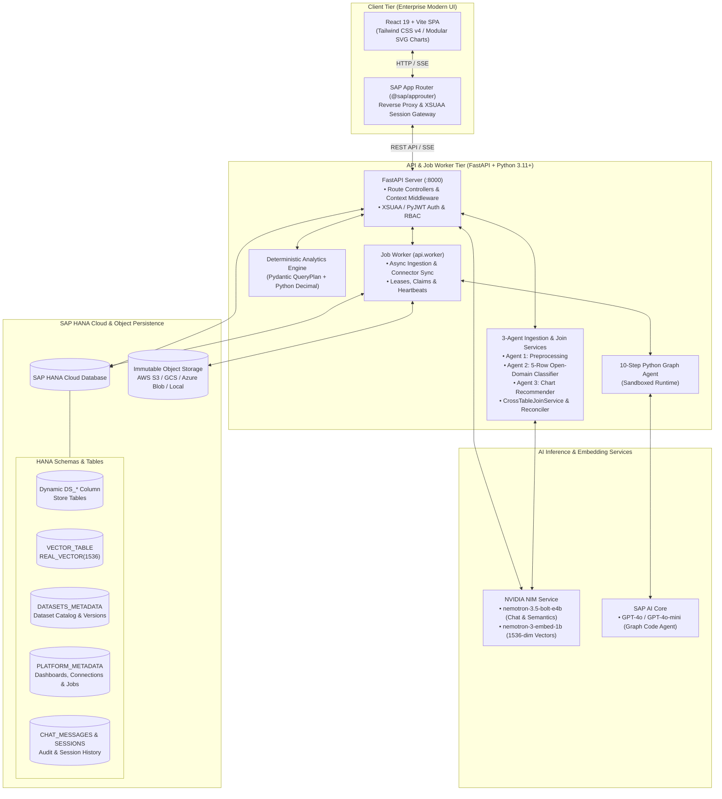

# GEN-AI Analytics Platform

[](https://www.sap.com/products/technology-platform.html)
[](https://help.sap.com/docs/hana-cloud)
[](https://help.sap.com/docs/sap-ai-core)
[](https://build.nvidia.com/)
[](https://fastapi.tiangolo.com/)
[](https://react.dev/)

An enterprise-grade, **zero-hardcode, metadata-driven Generative AI Analytics Platform** architected for **SAP BTP Cloud Foundry** and hybrid cloud environments. The platform unifies **Open-Domain 3-Agent Ingestion**, **Dynamic Cross-Table Joins**, **Dual-Path Deterministic Query Verification**, **SAP HANA Cloud Native Vector Engine RAG**, and a **3-Mode KPI & Graph Studio** into a governed, multi-dataset analytics suite.

---

## Table of Contents

- [Business Requirements & Value Proposition](#business-requirements--value-proposition)
- [System Architecture](#system-architecture)
- [Key Platform Capabilities](#key-platform-capabilities)
  - [1. 3-Agent Zero-Hardcode Dynamic Ingestion & Open-Domain Semantics](#1-3-agent-zero-hardcode-dynamic-ingestion--open-domain-semantics)
  - [2. Multi-Table Scoping, Reconciliation & Cross-Table Joins](#2-multi-table-scoping-reconciliation--cross-table-joins)
  - [3. Executive Analytics Dashboard & Modular Chart Library](#3-executive-analytics-dashboard--modular-chart-library)
  - [4. "Build Your KPI" 3-Mode Studio](#4-build-your-kpi-3-mode-studio)
  - [5. Cloud-Native RAG & Conversational AI Assistant](#5-cloud-native-rag--conversational-ai-assistant)
  - [6. SAP HANA Cloud Live Administration](#6-sap-hana-cloud-live-administration)
  - [7. Enterprise Data Connectors & Sync Engine](#7-enterprise-data-connectors--sync-engine)
  - [8. Real-Time Token Consumption & Cost Tracker](#8-real-time-token-consumption--cost-tracker)
- [Directory Structure](#directory-structure)
- [Tech Stack](#tech-stack)
- [Environment Configuration](#environment-configuration)
- [Local Development Setup](#local-development-setup)
- [Production Deployment (SAP BTP CF)](#production-deployment-sap-btp-cf)
- [API Reference](#api-reference)
- [Database Schema & Migrations](#database-schema--migrations)
- [Security, RBAC & Governance](#security-rbac--governance)
- [Testing & Quality Verification](#testing--quality-verification)

---

## Business Requirements & Value Proposition

Traditional enterprise BI tools suffer from rigid semantic schemas, manual ETL delays, and poor support for ad-hoc natural language exploration. Conversely, ungrounded Large Language Models (LLMs) hallucinate numerical totals, depend on hardcoded domain assumptions, and lack enterprise governance.

The **GEN-AI Analytics Platform** fulfills seven core enterprise business requirements:

1. **Zero-Hardcode Open-Domain Intelligence**:
   - Any uploaded file or connected enterprise data source is profiled automatically from its own schema and sample records—inferring domain, grain, column roles, and visualizations dynamically with zero fixed domain lists.
   - An autonomous **3-Agent Pipeline** cleans raw tables (including complex multi-row Excel headers), samples the **first 5 rows** via zero-shot LLM reasoning to infer domain, grain, column roles, units, and synonyms, and recommends curated KPIs/charts automatically.
2. **Dual-Path Mathematical Verification**:
   - Eliminates LLM numerical hallucinations by executing analytical query plans against immutable dataset snapshots and HANA column tables using Pydantic AST validation and 38-digit Python `Decimal` arithmetic.
   - LLMs interpret intent and summarize insights; deterministic engines calculate totals, margins, ratios, and deltas.
3. **100% Cloud-Native Retrieval & Dynamic HANA Persistence**:
   - Runtime analytics and RAG retrieval operate directly on **SAP HANA Cloud** (dynamic `DS_*` column tables and `VECTOR_TABLE` with `REAL_VECTOR(1536)` cosine similarity) with zero runtime dependency on local preprocessing disk files.
4. **Multi-Table Scoping & Dynamic Cross-Table Joins**:
   - Multi-sheet Excel workbooks are unbundled into independent first-class datasets backed by dedicated HANA tables, reconciled automatically with `DATASETS_METADATA`.
   - Join discovery (`join_service.py`) dynamically detects cross-table key relationships via schema matching, semantic role scoring, and live value overlap.
5. **Enterprise Governance, Versioning & Cascade Lifecycle**:
   - Datasets maintain immutable version histories (`v1`, `v2`, ...) and semantic revision approvals before dashboard publication.
   - Cascade deletion (`DELETE /api/datasets/{id}`) and protected table management ensure clean synchronization across catalog, HANA tables, and vector embeddings.
6. **Universal Integration Fabric**:
   - Connects to SAP S/4HANA (OData), SAP Analytics Cloud (SAC Data Export), SAP HANA Cloud, REST, OData v2/v4, SOAP (Zeep), AWS S3, Google Cloud Storage, and Azure Blob Storage with Fernet-encrypted credentials.
7. **Multi-Turn Business Simulation (What-If Analysis)**:
   - Supports live parameter simulations (e.g., unit quantity or pricing changes) calculating simultaneous multi-metric deltas across Revenue, Cost, and Gross Margin with safe `Decimal` serialization over SSE.

---

## System Architecture



---

## Key Platform Capabilities

### 1. 3-Agent Zero-Hardcode Dynamic Ingestion & Open-Domain Semantics
Orchestrated by `upload_service.py` and tracked visually in the frontend via `AIAgentIngestionStepper.tsx`:
- **Complex Workbook Discovery**: Handles multi-sheet Excel workbooks (`.xlsx`, `.xls`) and CSVs with multi-row/complex header detection, delimiter inference, and live import preview (`FileImportReview.tsx`).
- **Agent 1 (`agent_preprocessing.py`)**: Autonomous data sanitization—normalizes headers, drops empty rows/columns, deduplicates records, and cleans string-encoded currencies and numbers.
- **Agent 2 (`agent_domain_classifier.py`)**: **Open-Domain 5-Row Semantic Intelligence**—passes only column profiles and the first 5 rows to zero-shot LLM reasoning (with offline statistical heuristic fallback) to infer any domain, row grain, field roles (`measure`, `dimension`, `time`, `identifier`), units/currencies, and domain synonyms without hardcoded taxonomies.
- **Dynamic Cloud Table Creation**: Persists cleaned tables directly into SAP HANA Cloud (`DS_<NAME>_V<N>` or user-specified `target_table_name` with `replace`/`append`/`none` actions) and registers immutable version manifests in `DATASETS_METADATA`.
- **Agent 3 (`agent_chart_recommender.py`)**: Proposes 4–6 domain-tailored KPI scorecards and charts with precomputed live preview data and `[x] Include on Dashboard` selection (`RecommendationModal.tsx` -> `POST /api/dashboard/publish-recommended`).

### 2. Multi-Table Scoping, Reconciliation & Cross-Table Joins
- **Automated Table Reconciliation (`reconciliation_service.py`)**: Inspects physical SAP HANA Cloud user tables (`SYS.TABLES` / `SYS.M_TABLES`), unbundles multi-sheet workbooks into independent first-class datasets, and syncs catalog provenance via `POST /api/datasets/reconcile-tables`.
- **Dynamic Cross-Table Join Discovery (`join_service.py`)**: Discovers join edges across workspace datasets (`GET /api/analytics/join-graph`, `POST /api/analytics/resolve-join`) using normalized column matching, semantic role scoring, and live value overlap—with zero hardcoded table names.
- **Cascade Dataset Lifecycle**: `DELETE /api/datasets/{dataset_id}` cascades cleanly across the catalog, `DATASETS_METADATA`, the physical HANA column table, and scoped embeddings in `VECTOR_TABLE`.

### 3. Executive Analytics Dashboard & Modular Chart Library
Powered by `AnalyticsWidget.tsx` and the modular chart suite in `frontend/src/components/charts/`:
- **Modular SVG & Data Widgets**: `CartesianChart.tsx` (bar, line, area, stacked), `HorizontalBarChart.tsx`, `PieDonutChart.tsx`, `FunnelChart.tsx`, `GaugeChart.tsx`, `RadarChart.tsx`, and `DataTableWidget.tsx`.
- **Precision Formatting & Temporal Sorting (`chartUtils.ts`)**: Collision-free temporal X-axis sorting (`parseTemporalSortKey`), humanized column headers, currency/percentage formatting, and tabular numerals.
- **Context Bar Synchronization**: Dataset, version, and approved semantic revision headers (`X-Dataset-Id`, `X-Dataset-Version`, `X-Semantic-Revision`) bind every dashboard widget to its exact snapshot.

### 4. "Build Your KPI" 3-Mode Studio
Located under `Build Your KPI` (`GraphStudio.tsx`), offering three creation pathways:
- **Mode 1 — Visual KPI & Widget Builder**: No-code form for selecting measures, aggregations (`SUM`, `AVG`, `COUNT`, `MIN`, `MAX`), dimensions, and widget types; saves proposals for review and publication.
- **Mode 2 — AI Core Custom Graph (10-Step Sandboxed Python Agent)**: Uses SAP AI Core GPT-4o-mini and Matplotlib/Seaborn to inspect schema, precompute verified numeric aggregates, generate an isolated script (`temp_graph_<id>.py`), execute with a 60s timeout, emit base64 PNGs, and auto-clean temporary artifacts (`POST /api/graph/python-agent/generate`).
- **Mode 3 — Data-Driven Automated Custom Graph**: Structured visual controls for advanced statistical plots (Heatmaps, Waterfall Bridges, Treemaps, Violin/Box Plots, Pareto charts) without writing prompts.

### 5. Cloud-Native RAG & Conversational AI Assistant
- **Scoped Vector Retrieval**: Real-time cosine similarity search across 1536-dimensional embeddings in `VECTOR_TABLE` scoped strictly to the active dataset/table (`RAGChat.tsx`, `vector_service.py`).
- **Hybrid Relational + Vector Context**: Combines semantic document chunks with live SQL aggregations and direct order/record lookups in SAP HANA Cloud.
- **Token-by-Token SSE Streaming**: Real-time streaming via `POST /api/chat/stream` with an expandable **Thinking Process Inspector** (`ThinkingProcess.tsx`), source citations, and session history persistence.
- **What-If Simulation Engine**: Computes simultaneous multi-metric adjustments across Revenue, Cost, and Gross Margin with centralized `Decimal` and `DateTime` JSON normalization.

### 6. SAP HANA Cloud Live Administration
Dedicated administration console (`/hanaadmin`, `HanaAdmin.tsx`, `hana_table_service.py`):
- **Instance Telemetry**: Live HANA connection health, uptime, memory/CPU utilization, and schema summary.
- **Dynamic Table Inspector**: Lists user and system tables with row counts, memory footprints, schema reflection, and paginated data preview.
- **Read-Only SQL Console**: Admin-only bounded `SELECT` / `WITH` SQL workbench (`POST /api/hanaadmin/query`).
- **Range Deletion & Safe Table Drops**: Targeted row-range, ID-range, or key-value deletions (`POST /api/hanaadmin/tables/{table_name}/delete-range`) and safe table drops (`DELETE /api/hanaadmin/tables/{table_name}`) with strict protection blocking drops of system tables (`DATASETS_METADATA`, `PLATFORM_METADATA`, `PLATFORM_DOCUMENTS`, `VECTOR_TABLE`, `CHAT_MESSAGES`, `CHAT_SESSIONS`).

### 7. Enterprise Data Connectors & Sync Engine
Managed via **Data Sources** (`DataSources.tsx`) and **System Management** (`SystemSettings.tsx`):
- **Supported Sources**: SAP S/4HANA (OData), SAP ICSM (`sap_icsm`), SAP Analytics Cloud (SAC FactData/MasterData), SAP HANA Cloud, REST APIs, OData v2/v4, SOAP (Zeep WSDL), AWS S3, Google Cloud Storage, and Azure Blob Storage.
- **Auto-Semantic & HANA Sync**: Every connector sync automatically runs open-domain semantic classification and dynamic SAP HANA Cloud table provisioning (`DS_*`) alongside immutable snapshot versioning.
- **Recoverable Worker Queue**: Persistent jobs (`jobs.py`) using compare-and-swap claims, dataset leases, heartbeats, cooperative cancellation, and idempotency receipts.
- **Encrypted Credential Vault**: Connector secrets encrypted at rest with Fernet (`PLATFORM_CREDENTIAL_KEY`).

### 8. Real-Time Token Consumption & Cost Tracker
- Built-in telemetry via `backend/api/utils/calculate_token_usage.py` and root `calculate_token_usage.py`, logging every AI inference call to `.token_usage.jsonl` with prompt tokens, completion tokens, latency, and estimated USD cost.

---

## Directory Structure

```
GEN-AI-Analytics-Platform/
├── mta.yaml                          # SAP BTP Cloud Foundry MTA deployment manifest
├── package.json                      # Root workspace scripts & orchestrations
├── xs-security.json                  # SAP BTP XSUAA authorization descriptor
├── default-env.json                  # Local CF VCAP environment configuration
├── deployment.private.mtaext         # Private MTA deployment extension overrides
├── calculate_token_usage.py          # Real-time CLI token consumption monitor
├── generate_embeddings.py            # CLI batch vector embedding generator
├── .token_usage.jsonl                # Token consumption audit ledger
├── .env.example                      # Environment configuration template
│
├── router/                           # SAP App Router (Node.js)
│   ├── server.js                     # Gateway entry point
│   ├── xs-app.json                   # Route rules & XSUAA security constraints
│   ├── auth-navigation.js            # Auth redirect helper
│   ├── public/                       # Login & logged-out static pages
│   └── package.json                  # App Router dependencies (@sap/approuter)
│
├── backend/
│   ├── Procfile                      # Cloud Foundry process configuration
│   ├── requirements.txt              # Production Python package manifest
│   ├── requirements-connectors.txt   # Enterprise cloud connectors manifest
│   │
│   ├── api/                          # FastAPI Backend Application
│   │   ├── app.py                    # App initialization, CORS allowlist & router registration
│   │   ├── config.py                 # Pydantic Settings & VCAP_SERVICES parser
│   │   ├── worker.py                 # Asynchronous background job worker process
│   │   ├── xsuaa.py                  # SAP XSUAA / PyJWT validation middleware
│   │   │
│   │   ├── platform/                 # Metadata Platform, Agents & Data Governance Core
│   │   │   ├── agent_preprocessing.py       # Agent 1: Zero-hardcode data cleaning & coercion
│   │   │   ├── agent_domain_classifier.py   # Agent 2: Open-domain 5-row semantic intelligence
│   │   │   ├── agent_chart_recommender.py   # Agent 3: Tailored KPI & chart recommender
│   │   │   ├── datasets_metadata_repository.py # DATASETS_METADATA HANA/SQLite persistence
│   │   │   ├── join_service.py              # Dynamic cross-table join discovery & resolution
│   │   │   ├── reconciliation_service.py    # HANA physical table & multi-sheet reconciler
│   │   │   ├── store.py                     # Revision-checked PLATFORM_METADATA store
│   │   │   ├── storage.py                   # Object Storage abstraction (S3/GCS/Azure/Local)
│   │   │   ├── contracts.py                 # Pydantic domain & transformation contracts
│   │   │   ├── semantic.py                  # Semantic modeling engine & AST evaluation
│   │   │   ├── planning.py                  # Analytics planning & NL query-plan builder
│   │   │   ├── connections.py               # Encrypted connection management
│   │   │   ├── connectors.py                # Connectors (REST, OData, SAP, SOAP, S3/GCS/Azure)
│   │   │   ├── jobs.py                      # Recoverable job queue, claims & heartbeats
│   │   │   ├── ingestion.py                 # Workbook sheet discovery & parsing preparation
│   │   │   ├── formulas.py                  # Safe arithmetic expression AST evaluator
│   │   │   ├── charts.py                    # Deterministic chart rendering helpers
│   │   │   ├── custom_charts.py             # Isolated container chart runner
│   │   │   ├── workflow.py                  # Persisted ingestion/modeling workflow stages
│   │   │   └── ai_settings.py               # Dynamic AI provider configuration
│   │   │
│   │   ├── routes/                   # FastAPI REST & SSE Route Handlers
│   │   │   ├── health.py             # /api/health
│   │   │   ├── auth.py               # /api/auth (SSO, login, me, logout)
│   │   │   ├── users.py              # /api/users (User management & RBAC)
│   │   │   ├── dashboard.py          # /api/dashboard & /publish-recommended
│   │   │   ├── analytics.py          # /api/analytics
│   │   │   ├── chat.py               # /api/chat & session history CRUD
│   │   │   ├── chat_stream.py        # /api/chat/stream (SSE token streaming)
│   │   │   ├── graph.py              # /api/graph (/generate, /advanced, /python-agent/generate)
│   │   │   ├── upload.py             # /api/upload (chunked streaming + 3-agent orchestration)
│   │   │   ├── datasets.py           # /api/datasets (reconcile, versions, compare, cascade delete)
│   │   │   ├── semantic.py           # /api/semantic, /api/insights/*, /api/analytics/join-*
│   │   │   ├── system.py             # /api/system (connections, bindings, jobs, AI, storage, audit)
│   │   │   ├── database.py           # /api/database (table inspection)
│   │   │   └── hanaadmin.py          # /api/hanaadmin (stats, tables, query, delete-range, drop)
│   │   │
│   │   ├── services/                 # Business Logic Services
│   │   │   ├── analytics_engine.py   # Deterministic Pandas & 38-digit Decimal executor
│   │   │   ├── analytics_service.py  # Analytics orchestration service
│   │   │   ├── ai_core_service.py    # SAP AI Core & NVIDIA NIM unified LLM/embedding client
│   │   │   ├── dashboard_service.py  # Dashboard aggregation service
│   │   │   ├── data_service.py       # HANA data accessor & order lookup
│   │   │   ├── dataset_service.py    # Multi-version dataset catalog & cascade lifecycle
│   │   │   ├── excel_dataset_service.py # Workbook parsing & multi-sheet support
│   │   │   ├── history_service.py    # HANA persistent chat session & message history
│   │   │   ├── intent_engine.py      # NL intent classification & what-if parameter parser
│   │   │   ├── python_graph_agent.py # 10-step sandboxed Python visualization agent
│   │   │   ├── schema_service.py     # HANA & dataset schema reflection
│   │   │   ├── upload_service.py     # 3-Agent ingestion & dynamic HANA table pipeline
│   │   │   ├── vector_service.py     # Native HANA Cloud vector similarity search
│   │   │   └── xsuaa_users_service.py# XSUAA user & role management service
│   │   │
│   │   ├── database/                 # Database Connectivity
│   │   │   ├── connection.py         # Threaded connection pool manager (hdbcli)
│   │   │   ├── hana_client.py        # SAP HANA SQL execution client
│   │   │   ├── hana_table_service.py # Dynamic DDL/DML, stats, range delete & safe table drops
│   │   │   └── vector_client.py      # Vector similarity & scoped embedding CRUD
│   │   │
│   │   ├── rag/                      # Cloud-Native RAG Pipeline
│   │   │   ├── pipeline.py           # End-to-end RAG & hybrid SQL orchestration
│   │   │   ├── retriever.py          # Scoped vector + relational retrieval
│   │   │   ├── prompt_builder.py     # Context-aware prompt assembly
│   │   │   └── generator.py          # Streaming & synchronous response generation
│   │   │
│   │   ├── models/                   # Pydantic Models & Contexts
│   │   │   ├── execution_context.py  # DatasetSelection, ExecutionContext & access control
│   │   │   ├── query_plan.py         # Strict QueryPlan schema
│   │   │   ├── database_models.py    # Database schemas
│   │   │   ├── request_models.py     # Request payloads
│   │   │   └── response_models.py    # Response schemas
│   │   │
│   │   └── utils/                    # Shared Utilities
│   │       ├── auth.py               # Auth & admin guard helpers
│   │       ├── calculate_token_usage.py # Token ledger recorder & CLI monitor
│   │       ├── context_middleware.py # Dataset/version/semantic context middleware
│   │       ├── json_encoder.py       # Decimal & DateTime safe JSON serialization
│   │       ├── logger.py             # Structured logging
│   │       └── validation.py         # File & input validation
│   │
│   ├── db/                           # SAP HANA HDI Artifacts & SQL Migrations
│   │   ├── migrations/
│   │   │   ├── 001_platform_metadata.sql  # DDL for PLATFORM_METADATA
│   │   │   └── 002_datasets_metadata.sql  # DDL for DATASETS_METADATA
│   │   └── src/schema/
│   │       ├── datasets_metadata.hdbtable
│   │       ├── platform_documents.hdbtable
│   │       └── vector_table.hdbtable
│   │
│   ├── chart-worker/                 # Isolated Docker container for custom chart code
│   │   └── Dockerfile
│   │
│   └── tests/                        # 18 Backend Unit & Integration Test Suites
│       ├── test_advanced_analytics.py
│       ├── test_cascade_dataset_deletion.py
│       ├── test_chat_history.py
│       ├── test_chat_route_resilience.py
│       ├── test_connectors_jobs.py
│       ├── test_cross_table_joins.py
│       ├── test_datasets.py
│       ├── test_excel_complex_headers.py
│       ├── test_gc_objects.py
│       ├── test_hana_admin.py
│       ├── test_hana_connection.py
│       ├── test_migration_sandbox.py
│       ├── test_multi_table_scoping.py
│       ├── test_platform_foundation.py
│       ├── test_platform_integration.py
│       ├── test_semantic_ingestion.py
│       ├── test_xsuaa_users.py
│       └── test_zero_hardcode_dynamic.py
│
├── frontend/                         # React 19 + TypeScript SPA
│   ├── vite.config.ts                # Vite build & /api proxy configuration
│   ├── vitest.config.mjs             # Vitest test configuration
│   ├── tsconfig.json                 # TypeScript compiler options
│   │
│   └── src/
│       ├── App.tsx                   # Root application shell, auth & route controller
│       ├── main.tsx                  # DOM entry point
│       ├── index.css                 # Tailwind CSS v4 design tokens & theme variables
│       │
│       ├── screens/                  # Top-Level Application Views
│       │   ├── ExecutiveDashboard.tsx# Executive KPI cards, trends & published charts
│       │   ├── GraphStudio.tsx       # "Build Your KPI" 3-mode analytics studio
│       │   ├── RAGChat.tsx           # Streaming RAG assistant with Thinking UI
│       │   ├── AIAgents.tsx          # Multi-agent autonomous engineering studio
│       │   ├── DatasetIngestion.tsx  # Upload, 3-agent stepper & semantic review
│       │   ├── DataExplorer.tsx      # Interactive query console & chip selector
│       │   ├── HanaAdmin.tsx         # Live SAP HANA Cloud monitoring, SQL & table manager
│       │   ├── DataSources.tsx       # Enterprise data source integration catalog
│       │   ├── SystemSettings.tsx    # Connections, sync jobs, AI & storage settings
│       │   ├── UserManagement.tsx    # XSUAA role assignment & access audit
│       │   ├── ReportsLibrary.tsx    # Certified reports repository (demo mode)
│       │   ├── AlertsNotifications.tsx# Incident & alert feed (demo mode)
│       │   └── EnterpriseSignIn.tsx  # SAP XSUAA authentication screen
│       │
│       ├── components/               # Modular UI & Visualization Components
│       │   ├── AnalyticsWidget.tsx   # Unified widget router & data resolver
│       │   ├── AIAgentIngestionStepper.tsx # 3-Agent ingestion progress & audit UI
│       │   ├── RecommendationModal.tsx     # Agent 3 chart recommendation & publish modal
│       │   ├── ThinkingProcess.tsx   # Expandable agent reasoning stepper
│       │   ├── CommandPalette.tsx    # Global command launcher (Cmd+K)
│       │   ├── Sidebar.tsx           # Collapsible navigation sidebar
│       │   ├── Header.tsx            # Global header & active context bar
│       │   ├── DatasetContextBar.tsx # Dataset, version & semantic revision selector
│       │   ├── charts/               # Modular SVG Chart Suite
│       │   │   ├── CartesianChart.tsx
│       │   │   ├── HorizontalBarChart.tsx
│       │   │   ├── PieDonutChart.tsx
│       │   │   ├── FunnelChart.tsx
│       │   │   ├── GaugeChart.tsx
│       │   │   ├── RadarChart.tsx
│       │   │   ├── DataTableWidget.tsx
│       │   │   └── chartUtils.ts
│       │   └── dataset/              # Dataset Governance & Import Sub-components
│       │       ├── FileImportReview.tsx
│       │       ├── SemanticReview.tsx
│       │       ├── DatasetGovernance.tsx
│       │       ├── DatasetDeleteDialog.tsx
│       │       └── ...
│       │
│       ├── services/                 # Client API Service Layer
│       │   ├── api.ts                # Axios instance with context headers & error mapping
│       │   ├── chatbotService.ts     # SSE stream handler & session history
│       │   ├── hanaAdminService.ts   # HANA Cloud admin & table management client
│       │   ├── datasetService.ts     # Dataset CRUD, reconcile & versioning client
│       │   ├── semanticService.ts    # Semantic governance, joins & insights client
│       │   ├── uploadService.ts      # Discovery, preview & upload client
│       │   └── authService.ts        # Session, JWT and role helpers
│       │
│       └── __tests__/                # Frontend Vitest Suites
│           ├── dataset.test.ts
│           ├── multi_table_scoping.test.tsx
│           ├── platform.test.tsx
│           └── temporal_sort.test.tsx
│
├── docs/                             # Architectural & Implementation Documentation
│   ├── 3_AGENT_DYNAMIC_INGESTION_PLAN.md # Open-domain 5-row Agent 2 & 3-agent specs
│   ├── metadata-platform.md          # Governance, versioning, connectors & migrations
│   ├── build-your-kpi-implementation-plan.md # 3-mode studio specifications
│   ├── ui-ux-modernization-implementation-plan.md # Design system & screen specs
│   ├── architecture.md               # End-to-end platform architecture
│   ├── api.md                        # Detailed API guide
│   ├── deployment.md                 # Cloud Foundry deployment manual
│   ├── setup.md                      # Setup instructions
│   └── sap-auth-history-recovery.md  # XSUAA auth & history recovery guide
│
└── scripts/                          # DevOps & Maintenance Automation
    ├── check_sap_environment.py      # SAP BTP & HANA environment validator
    ├── migrate_metadata_platform.py  # Local-to-durable metadata migration tool
    ├── gc_objects.py                 # Unreferenced object storage garbage collector
    ├── run_jobs.py                   # CLI job worker runner (--once supported)
    ├── generate_embeddings.py        # Batch embedding loader
    ├── upload_data.py                # Bulk data uploader
    └── deploy.sh                     # Automated BTP build and deployment script
```

---

## Tech Stack

### Frontend Architecture
| Layer | Technologies |
|---|---|
| **Core Framework** | React `19.0.1`, TypeScript `~7.0.2` |
| **Build & Bundling** | Vite `^8.3.0`, `@vitejs/plugin-react` `^6.1.1` |
| **Styling & Tokens** | Tailwind CSS `^4.3.3` (`@tailwindcss/vite`), Autoprefixer |
| **Animations & Motion** | Motion (`motion/react` `^12.23.24`) |
| **Icons & Typography** | Lucide React `^0.546.0`, Geist font stack |
| **Networking & Streaming** | Axios `^1.20.0`, Native Fetch / EventSource (SSE) |
| **Markdown & Security** | Marked `^18.0.14`, DOMPurify `^3.4.16` |
| **Testing** | Vitest `^5.0.3`, `@testing-library/react` `^16.3.3`, Happy-DOM `^20.14.5` |

### Backend Architecture
| Layer | Technologies |
|---|---|
| **API Framework** | FastAPI `>=0.109.0,<1.0.0`, Starlette |
| **ASGI Server** | Uvicorn `[standard] >=0.27.0,<1.0.0` |
| **Data Engine** | Pandas `>=2.2.0,<3.0.0`, NumPy `>=1.26.0,<3.0.0`, OpenPyXL `>=3.1.2`, xlrd `>=2.0.1` |
| **Data Types & AST** | Pydantic `>=2.6.0,<3.0.0`, Python `decimal.Decimal` (38-digit precision) |
| **Database Driver** | SAP `hdbcli >=2.19.21,<3.0.0` (Threaded connection pool) |
| **Security & Auth** | SAP `sap-xssec >=4.0.0,<5.0.0`, PyJWT `>=2.8.0,<3.0.0`, Cryptography `>=41.0,<45.0` |
| **Enterprise Protocols** | Zeep `>=4.2,<5.0` (SOAP), Requests `>=2.31.0,<3.0.0` (REST / OData) |
| **Object Storage SDKs** | `boto3 >=1.34` (AWS S3), `google-cloud-storage >=2.16` (GCS), `azure-storage-blob >=12.19`, `azure-identity >=1.16` |
| **Visualization** | Matplotlib `>=3.8.0,<4.0.0`, Seaborn `>=0.13.0,<1.0.0` |

### Cloud & AI Infrastructure
| Service | Provider / Implementation | Purpose |
|---|---|---|
| **Database & Vector** | SAP HANA Cloud (HDI Container) | Relational column store + Vector Engine (`REAL_VECTOR(1536)`) |
| **Conversational & Semantic LLM** | NVIDIA NIM (`nvidia/nemotron-3.5-bolt-e4b`) | Streaming RAG chat, what-if synthesis & 5-row open-domain inference |
| **Text Embeddings** | NVIDIA NIM (`nvidia/nemotron-3-embed-1b`) | 1536-dim dense semantic vector embeddings |
| **Custom Code Agent** | SAP AI Core (GPT-4o / GPT-4o-mini) | 10-step sandboxed Python visualization generation |
| **App Gateway** | SAP App Router (`@sap/approuter` Node.js) | Reverse proxy, CSRF protection, static routing, XSUAA gateway |
| **Identity & Access** | SAP XSUAA | Enterprise OAuth2 JWT identity provider |
| **Platform Hosting** | SAP BTP Cloud Foundry | Container runtime & Multi-Target Application (`mta.yaml`) |

---

## Environment Configuration

Create a `.env` file in the project root (refer to `.env.example`):

```dotenv
# ==============================================================================
# 1. SAP HANA Cloud Configuration
# ==============================================================================
HANA_ADDRESS=your-hana-instance.hanadb.ondemand.com
HANA_PORT=443
HANA_USER=DBADMIN
HANA_PASSWORD=YourStrongHanaPassword!
HANA_SCHEMA=your-hana-schema
HANA_VALIDATE_CERT=true
HANA_POOL_SIZE=20
HANA_POOL_TIMEOUT=30.0

# ==============================================================================
# 2. NVIDIA NIM AI Configuration (RAG Chat, Semantics & Embeddings)
# ==============================================================================
NVIDIA_API_KEY=nvapi-your-nvidia-nim-api-key
NVIDIA_LLM_MODEL=nvidia/nemotron-3.5-bolt-e4b
NVIDIA_LLM_URL=https://integrate.api.nvidia.com/v1/chat/completions
NVIDIA_EMBEDDING_MODEL=nvidia/nemotron-3-embed-1b
NVIDIA_API_URL=https://integrate.api.nvidia.com/v1/embeddings

# ==============================================================================
# 3. SAP AI Core Configuration (10-Step Python Graph Agent)
# ==============================================================================
AICORE_AUTH_URL=https://<tenant>.authentication.sap.hana.ondemand.com/oauth/token
AICORE_CLIENT_ID=sb-your-client-id
AICORE_CLIENT_SECRET=your-client-secret
AICORE_RESOURCE_GROUP=default
AICORE_BASE_URL=https://api.ai.prod.eu-central-1.aws.ml.hana.ondemand.com/v2

# ==============================================================================
# 4. SAP XSUAA Security (Enterprise Auth)
# ==============================================================================
XSUAA_URL=https://<tenant>.authentication.sap.hana.ondemand.com
XSUAA_AUTH_URL=https://<tenant>.authentication.sap.hana.ondemand.com/oauth/token
XSUAA_CLIENT_ID=sb-your-xsuaa-client-id
XSUAA_CLIENT_SECRET=your-xsuaa-client-secret
XSUAA_XSAPPNAME=gen-ai-analytics-platform

# ==============================================================================
# 5. Metadata Platform & Job Worker Configuration
# ==============================================================================
PLATFORM_WORKSPACE_ID=default
PLATFORM_METADATA_BACKEND=hana            # 'hana' for production, 'sqlite' for local test
PLATFORM_DATASET_BACKEND=durable           # Durable immutable catalog
PLATFORM_OBJECT_BACKEND=local              # 'local', 's3', 'gcs', or 'azure_blob'
PLATFORM_CREDENTIAL_KEY=YourFernetKey32BytesUrlSafeBase64=
MAX_VERSIONS_PER_DATASET=0                 # 0 = retain all versions

# ==============================================================================
# 6. Application Runtime & Security Settings
# ==============================================================================
APP_ENV=development
LOG_LEVEL=INFO
PORT=8000
ALLOWED_ORIGINS=http://localhost:3000,http://127.0.0.1:3000,http://localhost:8000,http://127.0.0.1:8000
MAX_UPLOAD_SIZE_MB=50
```

> [!TIP]
> To generate a secure `PLATFORM_CREDENTIAL_KEY` for encrypting connector credentials, run:
> ```bash
> python -c "from cryptography.fernet import Fernet; print(Fernet.generate_key().decode())"
> ```

---

## Local Development Setup

### 1. Backend (FastAPI API + Job Worker)

```bash
# 1. Navigate to the backend directory
cd backend

# 2. Create and activate a Python virtual environment (Python 3.11+)
python -m venv venv

# Windows (PowerShell)
.\venv\Scripts\Activate.ps1
# Linux / macOS
source venv/bin/activate

# 3. Install core dependencies
pip install -r requirements.txt

# 4. Start the FastAPI API server (Terminal 1)
python -m uvicorn api.app:app --host 127.0.0.1 --port 8000 --reload
```

In a second terminal, start the background job worker (handles async connector syncs, custom chart worker jobs, and background dataset ingestion):

```bash
cd backend
.\venv\Scripts\Activate.ps1
python -m api.worker
```

- **Swagger API Documentation**: [http://localhost:8000/docs](http://localhost:8000/docs)
- **ReDoc Interactive Reference**: [http://localhost:8000/redoc](http://localhost:8000/redoc)
- **Health Check Endpoint**: [http://localhost:8000/api/health](http://localhost:8000/api/health)

### 2. Frontend (React 19 SPA)

```bash
# Navigate to the frontend directory
cd frontend

# Install exact dependencies from lockfile
npm ci

# Start the Vite development server (proxies /api to localhost:8000)
npm run dev
```

- **Web Application**: [http://localhost:3000](http://localhost:3000)

### 3. Parallel Token Usage Monitor (Optional)

To observe real-time token consumption, latency, and estimated inference costs while interacting with the platform:

```bash
# From the project root
python calculate_token_usage.py
# Or via the backend module:
python -m api.utils.calculate_token_usage
```

---

## Production Deployment (SAP BTP CF)

The platform is packaged as a Multi-Target Application (**MTA**) complying with SAP Cloud Foundry standards.

### MTA Module Architecture (`mta.yaml`)

| Module | Type | Target Runtime | Purpose |
|---|---|---|---|
| `gen-ai-analytics-platform-router` | `approuter.nodejs` | Node.js (128 MB) | Reverse proxy, static routing, XSUAA session validation |
| `gen-ai-analytics-platform-api` | `python` | Cloud Foundry Python (512 MB, autoscales to 2) | Core FastAPI backend and deterministic analytics engine |
| `gen-ai-analytics-platform-ui` | `html5` | HTML5 Application Repository | Pre-compiled static assets of the React 19 SPA |
| `gen-ai-analytics-platform-app-deployer` | `html5.application-content` | BTP Deployer Service | Deploys frontend build to SAP HTML5 repo |
| `gen-ai-analytics-platform-db-deployer` | `hdb` | SAP HDI Deployer (256 MB) | Executes database schema migrations in SAP HANA Cloud |

### Deployment Steps

1. **Install Prerequisites**:
   - [Cloud MTA Build Tool (`mbt`)](https://sap.github.io/cloud-mta-build-tool/): `npm install -g mbt`
   - [Cloud Foundry CLI (`cf`)](https://docs.cloudfoundry.org/cf-cli/install-go-cli.html) with the Multiapps plugin:
     ```bash
     cf install-plugin multiapps
     ```
2. **Authenticate with SAP BTP**:
   ```bash
   cf login -a https://api.cf.<region>.hana.ondemand.com -o <your-org> -s <your-space>
   ```
3. **Build & Deploy the MTA Archive**:
   ```bash
   mbt build -t ./
   cf deploy GEN-AI-Analytics-Platform_1.0.0.mtar
   ```

---

## API Reference

All application endpoints are served under the `/api` route prefix.

### Core & Authentication
| Endpoint | Method | Description |
|---|---|---|
| `/api/health` | `GET` | Verifies SAP HANA Cloud connection pool, schema validity, and AI provider readiness |
| `/api/auth/sso`, `/login`, `/me`, `/logout` | `POST`/`GET` | SAP XSUAA SSO, local authentication, user identity & role resolution |
| `/api/users` | `GET` | Lists enterprise platform users and RBAC role mappings |

### Executive Dashboard, Insights & Cross-Table Joins
| Endpoint | Method | Description |
|---|---|---|
| `/api/dashboard` | `GET` | Aggregated executive KPIs, monthly trend vectors, and published widgets |
| `/api/dashboard/publish-recommended` | `POST` | Approves semantic model and publishes selected Agent 3 chart recommendations |
| `/api/analytics` | `POST` | Natural language query execution with insights |
| `/api/analytics/join-graph` | `GET` | Discovers dynamic cross-table join relationships across workspace datasets |
| `/api/analytics/resolve-join` | `POST` | Resolves and validates a join configuration between two datasets |
| `/api/insights/execute` | `POST` | Executes a validated Pydantic `QueryPlan` with 38-digit Decimal precision |
| `/api/insights/recommendations` | `GET`/`POST` | Retrieves or creates independent analytical definition revisions |
| `/api/insights/definitions` | `POST` | Submits or reviews custom analytical widget definitions |
| `/api/insights/dashboard` | `GET`/`POST` | Retrieves or updates published dashboard widget configurations |

### RAG Chatbot & Streaming
| Endpoint | Method | Description |
|---|---|---|
| `/api/chat` | `POST` | Synchronous RAG query returning conversational answer and source citations |
| `/api/chat/stream` | `POST` | Server-Sent Events (SSE) stream delivering token-by-token LLM output, thinking steps, and citations |
| `/api/chat/sessions`, `/{session_id}` | `GET`/`DELETE` | Persistent conversation session listing, history retrieval, and deletion |

### "Build Your KPI" & Custom Graph Agent
| Endpoint | Method | Description |
|---|---|---|
| `/api/graph/generate` | `POST` | Deterministic DataFrame chart rendering from natural language or `QueryPlan` |
| `/api/graph/python-agent/generate` | `POST` | Executes the full 10-step sandboxed `PythonGraphAgent` (Mode 2 & Mode 3) |
| `/api/graph/advanced` | `POST` | Enqueues an isolated Docker container custom chart job (`PLATFORM_CHART_IMAGE`) |

### Dataset Lifecycle, Ingestion & Semantic Modeling
| Endpoint | Method | Description |
|---|---|---|
| `/api/upload/discover` | `POST` | Discovers sheets, tables, headers, and column data types inside uploaded files |
| `/api/upload/preview` | `POST` | Previews transformed records before committing an upload |
| `/api/upload` | `POST` | Chunked upload running the 3-Agent pipeline + dynamic HANA column table creation |
| `/api/datasets` | `GET` | Lists workspace datasets (supports `?sync_tables=true` for HANA reconciliation) |
| `/api/datasets/reconcile-tables` | `POST` | Reconciles physical HANA tables and unbundles multi-sheet workbooks |
| `/api/datasets/{id}/data`, `/versions`, `/compare` | `GET` | Reads immutable snapshots, version history, and schema/row diffs |
| `/api/datasets/{id}/rows`, `/append`, `/rollback` | `PUT`/`POST`/`DELETE` | Versioned row mutations, appends, and catalog pointer rollback |
| `/api/datasets/{id}` | `DELETE` | Cascade deletes dataset catalog entry, HANA table, metadata, and vectors |
| `/api/datasets/{id}/versions/{v}/semantics/*` | `GET`/`POST` | Proposes, edits, and approves/rejects semantic model revisions |

### SAP HANA Cloud Admin & Database Inspection
| Endpoint | Method | Description |
|---|---|---|
| `/api/hanaadmin` | `GET` | Complete HANA instance status, uptime, memory/CPU statistics, and table directory |
| `/api/hanaadmin/tables`, `/{name}`, `/{name}/schema`, `/{name}/data` | `GET` | Dynamic introspection of relational, vector, and metadata tables |
| `/api/hanaadmin/query` | `POST` | Admin-only read-only SQL `SELECT` / `WITH` workbench |
| `/api/hanaadmin/tables/{name}/delete-range` | `POST` | Targeted deletion by row index range, ID range, or parameterized key-values |
| `/api/hanaadmin/tables/{name}` | `DELETE` | Safely drops non-protected HANA tables with optional cascade dataset cleanup |
| `/api/database/tables` | `GET` | Lightweight table existence and preview routes |

### System Management & Integrations
| Endpoint | Method | Description |
|---|---|---|
| `/api/system/connector-types`, `/connections` | `GET`/`POST`/`PUT` | Configures, tests, discovers, and previews external enterprise sources |
| `/api/system/bindings`, `/{id}/sync` | `GET`/`POST` | Configures dataset sync bindings and enqueues idempotent sync jobs |
| `/api/system/jobs`, `/{id}/events`, `/{id}/cancel`, `/{id}/retry` | `GET`/`POST` | Monitors job progress via SSE and manages retries/cancellations |
| `/api/system/ai`, `/storage`, `/audit`, `/access` | `GET`/`PUT` | Configures AI providers, storage retention policies, and audits |

---

## Database Schema & Migrations

Apply explicit SQL migrations to your configured SAP HANA Cloud schema before production startup (`backend/db/migrations/`):

### 1. `DATASETS_METADATA` (`002_datasets_metadata.sql`)
Dedicated metadata catalog for datasets, immutable file versions, schema revisions, and ingestion provenance:
```sql
CREATE COLUMN TABLE DATASETS_METADATA (
    WORKSPACE_ID     NVARCHAR(100) NOT NULL DEFAULT 'default',
    DATASET_ID       NVARCHAR(100) NOT NULL,
    NAME             NVARCHAR(255) NOT NULL,
    FOLDER           NVARCHAR(255),
    CURRENT_VERSION  INTEGER DEFAULT 1,
    IS_ACTIVE        BOOLEAN DEFAULT FALSE,
    OWNER_ID         NVARCHAR(100),
    REVISION         BIGINT DEFAULT 1,
    VERSIONS_JSON    NCLOB,
    METADATA_JSON    NCLOB,
    UPDATED_AT       TIMESTAMP DEFAULT CURRENT_TIMESTAMP,
    PRIMARY KEY (WORKSPACE_ID, DATASET_ID)
);
```

### 2. `PLATFORM_METADATA` (`001_platform_metadata.sql`)
Revision-checked metadata document store for published dashboards, encrypted connections, sync bindings, and job state:
```sql
CREATE COLUMN TABLE PLATFORM_METADATA (
    NAMESPACE NVARCHAR(240) NOT NULL,
    DOCUMENT_ID NVARCHAR(240) NOT NULL,
    REVISION BIGINT NOT NULL,
    PAYLOAD NCLOB NOT NULL,
    PRIMARY KEY (NAMESPACE, DOCUMENT_ID)
);
```

### 3. `VECTOR_TABLE`
Dedicated vector storage for dataset-scoped RAG retrieval:
- `ID` (NVARCHAR): Deterministic vector chunk identifier.
- `CONTENT` (NCLOB): Textual record narrative or document slice.
- `EMBEDDING` (`REAL_VECTOR(1536)`): 1536-dimensional embedding vector computed by `nemotron-3-embed-1b`.
- `METADATA` (NCLOB): Structured JSON metadata (`dataset_id`, `version`, `table_name`, order/record identifiers).

### 4. Dynamic Dataset & Connector Tables (`DS_*`)
- Every uploaded file, workbook sheet, or connector sync can automatically provision and populate a typed SAP HANA Cloud column table (`DS_<NAME>_V<N>` or custom `target_table_name`).
- Schema introspection, KPIs, RAG queries, cross-table joins, and visualizations adapt dynamically to any domain's columns without hardcoded table or field assumptions.

---

## Security, RBAC & Governance

1. **Authentication & RBAC (`xsuaa.py`)**:
   - Authenticates via **SAP XSUAA** OAuth2 / `sap-xssec` and `PyJWT` in Cloud Foundry.
   - Enforces RBAC roles (`PlatformAdmin`, `DataEngineer`, `Analyst`, `Viewer`) on administrative routes (`/api/hanaadmin/*`, `/api/system/*`, dataset access).
2. **Strict CORS & Upload Bounds (`app.py`, `upload.py`)**:
   - CORS enforces an explicit `ALLOWED_ORIGINS` list alongside a regex allowing verified SAP BTP / Business Application Studio / HANA Cloud origins.
   - File uploads enforce chunked streaming capped at `MAX_UPLOAD_SIZE_MB` (default `50 MB`).
3. **Context-Scoped Isolation (`context_middleware.py`)**:
   - Numerical and chat routes enforce `X-Dataset-Id`, `X-Dataset-Version`, and `X-Semantic-Revision` headers so queries, joins, and RAG vector retrieval cannot leak across workspaces or versions.
4. **Protected System Tables & Credential Encryption**:
   - Administrative table drops explicitly forbid deleting core system tables (`DATASETS_METADATA`, `PLATFORM_METADATA`, `PLATFORM_DOCUMENTS`, `VECTOR_TABLE`, `CHAT_MESSAGES`, `CHAT_SESSIONS`).
   - Source credentials are encrypted at rest with Fernet (`PLATFORM_CREDENTIAL_KEY`).
5. **Sandboxed Graph Execution**:
   - The Python Graph Agent executes in ephemeral isolated subprocesses (or optional networkless Docker containers via `backend/chart-worker/Dockerfile`) with strict timeouts and automatic artifact cleanup.

---

## Testing & Quality Verification

Run the backend and frontend test suites to verify core functionality, multi-table scoping, cross-table joins, cascade deletions, and UI rendering:

```bash
# 1. Run all 18 backend unit & integration test suites
python -m unittest discover -s backend/tests -v

# 2. Run frontend unit tests (Vitest)
cd frontend
npm run test

# 3. Verify TypeScript compile-time typings
npm run lint

# 4. Verify production bundle build
npm run build
```

---

## Project Information

- **Platform Version**: `1.0.0`
- **License**: Apache-2.0 / Proprietary Enterprise
- **Maintainer**: Neovatic Analytics Platform Engineering Team
