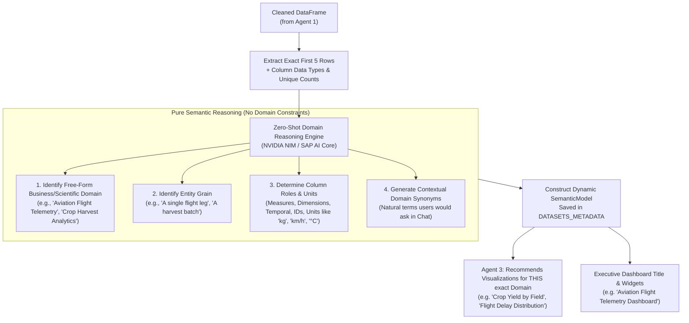

# Open-Domain 5-Row Semantic Intelligence (Zero-Hardcode Agent 2)
## Implementation Plan

**Objective:** Completely eliminate static domain classification dictionaries (`DOMAIN_TAXONOMY = {"sales": ..., "hr": ...}`) and replace them with **open-domain, zero-shot reasoning** on the **first 5 rows** of any uploaded or connected dataset.

---

## 1. The Problem with the Current Approach vs. Target Architecture

```
❌ PREVIOUS APPROACH:
5 Rows sampled ──> Match against hardcoded dictionary ──> Limited to [Sales, HR, Finance, Logistics, Healthcare, Support]
                   (If data is Agriculture, Real Estate, Gaming, Maritime, IoT, or Legal -> it fails or gets forced into a wrong bucket)

✅ OPEN-DOMAIN TARGET ARCHITECTURE:
5 Rows sampled ──> Pure Zero-Shot LLM Reasoning ──> Detects ANY Domain dynamically (e.g., "Precision Agriculture", "Maritime Fleet Tracking", "Clinical Genomics")
                   (Zero predefined categories. Zero hardcoded lists.)
```

---

## 2. Open-Domain 5-Row Agent Workflow



---

## 3. Technical Specification for Open-Domain Agent 2

### A. The Zero-Shot Prompt Contract
The LLM prompt passes only the **column names**, **data types**, and the **first 5 rows**:

```python
OPEN_DOMAIN_SYSTEM_PROMPT = """You are an expert enterprise ontologist and open-domain data scientist.
Analyze the following column names, data types, and the FIRST 5 ROWS of an unknown dataset.
Do not assume any pre-determined domain or business category. Infer the true domain directly from the data.

COLUMNS:
{columns_summary}

FIRST 5 SAMPLE ROWS:
{sample_rows_json}

Return ONLY a valid JSON object with the following schema:
{
  "domain": "Specific free-form domain or industry name (e.g., Precision Agriculture, Commercial Real Estate, Video Game Telemetry, Maritime Shipping, Clinical Trials)",
  "grain": "What a single row represents (e.g., One property appraisal, One player session, One vessel waypoint)",
  "fields": [
    {
      "name": "exact_column_name",
      "semantic_name": "Human-friendly label",
      "role": "measure | dimension | time | identifier",
      "default_aggregation": "SUM | AVG | COUNT | COUNT_DISTINCT | null",
      "unit": "e.g. kg, liters, km/h, %, or null",
      "currency": "e.g. USD, EUR, or null",
      "description": "Short explanation of what this column measures or represents in this domain",
      "synonyms": ["3 to 5 natural language synonyms or search phrases a business user would ask in chat"]
    }
  ]
}
"""
```

### B. Offline / Fallback Resiliency (Zero Downtime)
If the LLM API is temporarily unreachable or times out:
1. Infer roles using statistical heuristics:
   * Continuous numbers $\rightarrow$ `role: "measure"`, aggregation: `AVG` if column name contains rate/percent/ratio, else `SUM`.
   * Date-like strings/datetimes $\rightarrow$ `role: "time"`.
   * High-uniqueness strings ending in id/code/key $\rightarrow$ `role: "identifier"`.
   * Low-cardinality strings $\rightarrow$ `role: "dimension"`.
2. Infer domain from file name and column word stems (clean free-form label, e.g. filename `Maritime_Tracking.csv` $\rightarrow$ `"Maritime Tracking"`).

---

## 4. File Modification Matrix

| Component | Path | Action | Description |
| :--- | :--- | :--- | :--- |
| **Agent 2 Implementation** | `backend/api/platform/agent_domain_classifier.py` | **Update** | Remove `DOMAIN_TAXONOMY` dictionary completely. Implement the open-domain zero-shot 5-row LLM prompt and parse dynamic domain titles, entity grain, and contextual synonyms. |
| **Unit & E2E Tests** | `scratch/test_open_domain_agent.py` | **Create** | Test with 3 completely novel non-standard domains: 1) Astronomy / Exoplanet telemetry; 2) Agriculture / Soil moisture; 3) Maritime shipping. Verify that Agent 2 detects each domain naturally without any dictionary. |
| **Documentation** | `docs/3_AGENT_DYNAMIC_INGESTION_PLAN.md` | **Update** | Update Section 3 (Agent 2) to document the open-domain 5-row discovery pattern. |

---

## 5. Verification Scenarios

1. **Test Case 1: Precision Agriculture**
   * Sample 5 rows: `Crop_Type: "Soybean"`, `Soil_Moisture_Pct: 24.5`, `Rainfall_mm: 12.0`, `Yield_Tons_Per_Hectare: 3.8`.
   * **Expected Agent 2 Output**: Domain = `"Precision Agriculture"` or `"Crop Harvest Management"`, units = `["%", "mm", "tons"]`.
2. **Test Case 2: Maritime Shipping Fleet**
   * Sample 5 rows: `Vessel_IMO: "9412345"`, `Vessel_Name: "Ever Fortune"`, `Speed_Knots: 18.2`, `Destination_Port: "Rotterdam"`.
   * **Expected Agent 2 Output**: Domain = `"Maritime Logistics"` or `"Vessel Fleet Tracking"`, unit = `"knots"`.
3. **Test Case 3: Video Game Telemetry**
   * Sample 5 rows: `Player_ID: "P-8812"`, `Match_Duration_Sec: 420`, `Kills: 14`, `XP_Earned: 2450`, `Map_Name: "Dust_Valley"`.
   * **Expected Agent 2 Output**: Domain = `"Video Game Telemetry"` or `"Player Match Analytics"`.
