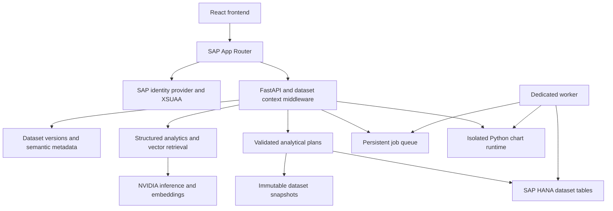

# System Architecture

The platform combines a React frontend, a FastAPI API, SAP HANA Cloud, immutable dataset snapshots, and AI services for semantics, retrieval, explanations, and custom charts.

## Components

| Component | Implementation and purpose |
| --- | --- |
| Frontend | React 19, TypeScript, Vite and Tailwind; dataset ingestion, exploration, dashboards, chat and administration |
| App Router | `router/server.js` and `router/xs-app.json`; SAP sign-in, static assets and authenticated API forwarding |
| API | `backend/api/app.py`; request context middleware and feature routers |
| Ingestion | `upload_service.py`; preprocessing, version creation, semantic inference, HANA persistence and recommendations |
| Analytics | `analytics_engine.py`; validated query plans, HANA execution and deterministic snapshot calculations |
| Persistence | `DATASETS_METADATA`, `PLATFORM_DOCUMENTS`, dynamic dataset tables, vector storage and configurable object storage |
| Worker | `api.worker`; leased indexing, connector sync and advanced-chart jobs |
| AI | NVIDIA chat/embedding services and SAP AI Core chart-code generation |

## Request flow

Locally, Vite on port 3000 proxies `/api` directly to FastAPI on port 8000. The deployed router supplies the hosted SAP session.

## Dataset lifecycle

CSV and workbook imports are parsed with selected header/sheet/locale options. Preprocessing normalizes headers and cleans data while respecting explicit parsing types and duplicate policy. Snapshots preserve identifiers, Decimal values and timestamps. A normalized export is retained alongside version metadata; ingestion does not rewrite earlier snapshots.

Domain classification uses column profiles and five sample rows. Semantic approval and workspace-wide upload sharing retain the current self-service defaults. `PLATFORM_AUTO_APPROVE_SEMANTICS=false` requires explicit semantic review; `PLATFORM_CHAT_WORKSPACE_ACCESS=false` applies dataset reader grants to chat as well. Categorical null labeling remains the default; `PLATFORM_CATEGORICAL_NULL_POLICY=preserve` retains source categorical nulls.

The upload response distinguishes successful and partial ingestion. Failed HANA storage stages remain visible, and partial imports cannot publish dashboards. `POST /api/datasets/{id}/retry-ingestion?version=N` retries saved storage without creating another version. Failed appends require destination reconciliation before retry because some rows may have committed.

## Analytics and retrieval

Middleware verifies SAP identity, workspace membership and selected dataset access, then pins dataset/version/semantic context for the request, including SSE completion. Graph body selections use the same authorization helpers and preserve the authenticated identity.

The analytics engine validates fields and aggregations before selecting an execution backend. Eligible single-table plans execute parameterized HANA SQL, including date ranges and literal text matching. Historical versions, joins, derived metrics and comparisons use complete snapshots/DataFrames. Historical requests do not reuse mutable current-version tables. Table resolution requires an exact mapping and never chooses an unrelated table by size or fuzzy name.

SQL and DataFrame results expose the actual backend, context, filtered input-row count and completeness. SQL failures can fall back to the pinned snapshot and include a warning. DataFrame calculations never use a bounded schema sample as the complete dataset. Complex full-data calculations can require substantial memory; they are not silently truncated.

Chat separates record lookup, numerical plans, simulations and explanatory vector retrieval. Numerical errors and empty results return explicit statuses rather than a successful answer synthesized from sample chunks. Scoped vector search retains dataset versions and cannot fall back to an unrestricted vector query. Workspace-wide retrieval is limited to accessible datasets when a verified identity is present.

Greetings and available-data questions read the authorized dataset catalog directly and bypass snapshot/semantic/AI setup. Simple explicit aggregates resolve against current semantic field names and aliases before AI planning. Calculated answers and exact record values are formatted directly, without model rewriting or inferred dollar units. Explanatory RAG requires matching evidence; missing evidence produces an explicit response. See [RAG chat behavior and validation](rag-chat-improvements.md).

## Chart execution

Routine charts render validated results using application-owned code. Both custom-Python graph paths use the isolated container executor in `platform/custom_charts.py`. Generated code receives approved data through a read-only mount; the container has no application credentials, no network, limited CPU/memory/processes, a bounded output and a timeout. The API host does not execute generated scripts.

Python chart generation requires `PLATFORM_CHART_IMAGE` on a Docker-capable runtime. Configuring an image name on a Cloud Foundry Python buildpack does not supply Docker. Deploy a compatible chart runtime before using these paths.

## Workers and deployment

The main MTA assembles the frontend into the router and deploys the API and worker with SAP service bindings. Its worker module runs `python -m api.worker` for indexing and connector jobs. Configure the worker's AI credentials and provider settings using private environment/service bindings.

Workers heartbeat into persistent metadata. Administrators can inspect `GET /api/system/workers/health`; a missing/stale worker is reported unavailable. Workers retry loop-level failures without silently exiting. Advanced Python jobs also need the isolated runtime described above.

See [setup](setup.md), [API](api.md), and the [remediation notes](code-review-remediation.md) for validation and operational requirements.
